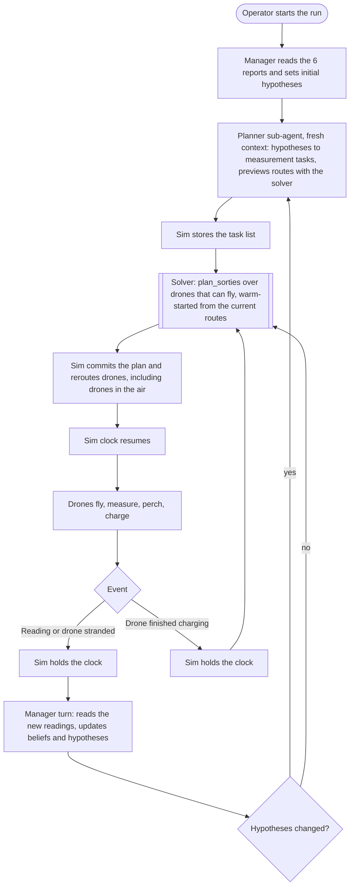
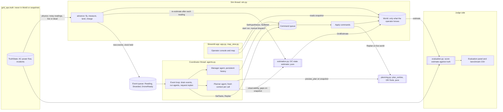
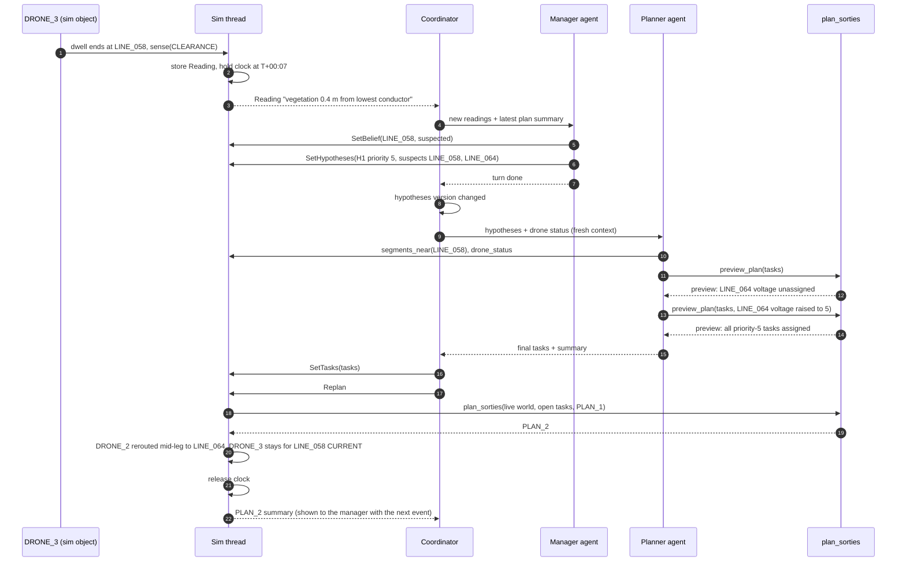
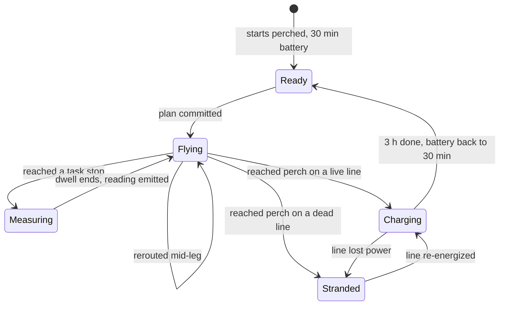

# Measurement planner design

This doc covers how the manager agent's root cause hypotheses turn into drone routes, and how every measurement feeds back into the hypotheses and the routes. It is a design only. Nothing here is implemented yet.

## Premises

- **The map is not a 2D grid.** Drones fly in straight lines between points (`world.distance_km`), so we don't need pathfinding. The problem is choosing which measurement stops each drone visits on one flight. That is a team orienteering problem. Each drone has its own start, an airtime budget, and a reward per stop, and it must end perched on a live line.
- **Speed turns distance into time.** A leg costs `distance_km / speed + dwell` minutes, and the budget is whatever airtime the drone has left. Range is not a separate constraint because it follows from speed × airtime. With today's 60 km/h (`SPEED_KM_PER_MINUTE = 1.0`), a full flight covers 30 km, which is about the width of the study area.
- **The problem is small.** Charging takes 3 hours, and the scenario window is 4 hours. Each of the 5 drones gets at most 2 flights. The solver finishes in milliseconds.
- **A flight must visit several stops.** Today `dispatch` flies to one segment midpoint, then lands and charges. A flight has to visit several stops and end on a perch. Assumption: dwell time at a stop counts against airtime.
- **The planner must use what the operator believes.** It chooses perches from `world.belief`, never from ground truth.
- **Today there is no route optimization.** The only ranking is [agents.py:85](../src/grid_ops/agents.py), which sorts reachable segments by distance so the drone agent's LLM can pick one. No solver is installed.
- **Today there is no power flow.** `PowerModel` in [grid.py](../src/grid_ops/grid.py) adds external grids and calls `top.unsupplied_buses`, so it only answers whether each line is live or dead. It never calls `runpp`, and the model has no loads, generators or transformers. The dataset has no current, power or load values either.
- **The grid state has to be estimated from samples.** The design adds a made-up ground truth power flow that the system never sees. Drones sample it, a state estimator rebuilds the flows from those samples, and an evaluator scores the rebuild against the truth.

## Agentic workflow

There are two agents and one solver. The manager reasons about root causes and owns the hypotheses. The planner sub-agent turns hypotheses into measurement tasks. The solver, a pure `plan_sorties` function, assigns tasks to drones and orders them. There are no drone agents. Drones are simulated objects that fly the committed routes.

Every reading goes straight to the manager. Afterwards, the solver always recomputes the routes. The planner LLM runs only when the manager actually changed the hypotheses, because unchanged hypotheses produce the same tasks.



## Architecture

The sim thread stays the only writer of `World`, as it is today. The coordinator thread runs both agents. Agents change the world only by submitting commands. The solver runs inside the sim thread on the live world, so a committed plan is never computed from a stale snapshot.



| Module | Owns |
|---|---|
| `world.py` | Domain types, drone state machine, `advance`. `advance` takes a `Physics` callback, so `world.py` never imports ground truth. |
| `truth/` | Ground-truth pandapower network, its AC power flow, incidents, and `Physics` (noisy sensing, live or dead). Only `sim.py` and `evaluation.py` may import it. |
| `estimation.py` | DC weighted-least-squares state estimator, observability check, measurement ranking. Pure. |
| `evaluation.py` | Scores each estimate against ground truth, and runs the headless benchmark. |
| `planning.py` | `plan_sorties`, the OR-Tools model, plan summaries. Pure, no threads, no I/O. |
| `sim.py` | The sim thread, commands, the event queue, holding and releasing the clock |
| `agents.py` | Manager and planner agents, their tools, and the coordinator event loop |
| `app.py`, `map_view.py` | Operator console. It starts the coordinator and draws routes and readings. |

## Example request

This example shows one reading flowing through the system. The scenario is hypothetical and labelled as such. The IDs come from the real dataset. The reading, priorities and plan are made up.

At T+00:00 the manager has set four hypotheses. H1 is vegetation contact in the SYN_REPORT_02 area (LINE_025, LINE_026, LINE_058, LINE_064), priority 3. H2 is a hot joint in the SYN_REPORT_05 area, priority 3. H3 is conductor clashing in the SYN_REPORT_06 area, priority 3. H4 is the cause of the LINE_024 trip, priority 5. PLAN_1 sent DRONE_3 from LINE_026 to measure clearance on LINE_058.



If the manager had left the hypotheses unchanged, steps 9 to 16 would be skipped. The coordinator would go straight to Replan, and the solver would recompute routes over the remaining tasks without any planner tokens.

## Events

| Event | Manager turn | Planner call | Solver replan |
|---|---|---|---|
| Reading taken | Yes | Only if hypotheses changed | Yes |
| Drone stranded on a dead line | Yes | Only if hypotheses changed | Yes |
| Drone finished charging | No | No | Yes |
| Drone landed on a live line | No | No | No, it is charging |

- **The sim holds the clock itself.** When `advance` produces an event, the sim thread sets `hold` in the same tick, so the world freezes at the moment of the reading. The coordinator releases it after Replan. `hold` is separate from the operator's Paused toggle, because `app.py` rewrites `sim.paused` on every rerun.
- **Events are batched.** The coordinator drains every queued event into one manager message. Two readings in the same tick become one manager turn and one replan.
- **Agent time is free.** The sim runs one sim minute per real second by default. Without the hold, a 20-second manager and planner round would cost 20 sim minutes of flight. Assumption: decision time does not count in the exercise.
- **A failed agent turn still replans.** If the manager or planner errors, the coordinator logs it, runs Replan with the existing tasks, and releases the clock.

## Replanning rules

Each drone joins a replan based on its state.

| Drone state | Replanned? | Route starts from | Airtime budget |
|---|---|---|---|
| Ready | Yes | Its perch | `battery_min`, which is 30 |
| Flying between stops | Yes | `position`, in the air | `battery_min` |
| Measuring at a stop | Yes, after the dwell ends | That stop | `battery_min` minus the dwell left |
| Charging | No | | |
| Stranded | No | | |

- **Charging drones stay put.** The rules require a full 3-hour charge before the next flight.
- **A measurement in progress finishes.** A half-finished reading is worth nothing, and dwell times are a few minutes.
- **Warm start from the current routes.** The drones' remaining routes go to OR-Tools as the starting solution (`ReadAssignmentFromRoutes`). Local search only accepts improvements, so the new plan is never worse than continuing, scored with the new priorities.
- **A switching cost against thrashing.** Changing a drone's next stop costs a fixed penalty. It is larger than any possible airtime saving and smaller than the reward of a priority-1 task. So a drone diverts only to gain value, never to save a few minutes.
- **Tasks have stable IDs.** A task's ID is `segment_id:kind:offset_km`. A task that already has a reading is never planned again, and the warm start can match old routes to new tasks.

## Data shape

```python
class Measurement(StrEnum):
    VOLTAGE_PRESENCE = "voltage_presence"   # E-field: is the line live?
    CURRENT = "current"
    CONDUCTOR_TEMP = "conductor_temp"       # hot joints, only visible on a loaded line
    CLEARANCE = "clearance"                 # sag / vegetation distance
    MOTION = "motion"                       # galloping, clashing

DWELL_MINUTES = {VOLTAGE_PRESENCE: 1, CURRENT: 2, CONDUCTOR_TEMP: 3, CLEARANCE: 3, MOTION: 4}

@dataclass(frozen=True)
class Hypothesis:               # manager → sim → planner
    id: str
    claim: str
    suspect_segments: tuple[str, ...]
    priority: int               # 1-5, how much the manager wants it tested

@dataclass(frozen=True)
class MeasurementTask:          # planner → sim → solver
    id: str                     # f"{segment_id}:{kind}:{offset_km:.1f}"
    hypothesis_id: str
    point: LinePoint            # where on the line to measure
    kind: Measurement
    priority: int               # 1-5; the solver's prize

@dataclass(frozen=True)
class CircuitFlow:
    circuit: int
    current_a: float
    p_mw: float                 # signed, positive from from_node to to_node
    q_mvar: float

@dataclass(frozen=True)
class Reading:                  # sim → coordinator → manager
    task_id: str
    drone_id: str
    clock: float
    summary: str                # what the manager reads, e.g. "vegetation 0.4 m from lowest conductor"
    flows: tuple[CircuitFlow, ...] = ()   # CURRENT readings only
    voltage_kv: float | None = None       # VOLTAGE_PRESENCE readings only

@dataclass(frozen=True)
class Sortie:
    drone_id: str
    stops: tuple[str, ...]      # task ids, in order
    perch_segment: str          # believed-live line it ends on
    airtime_minutes: float

@dataclass(frozen=True)
class Plan:
    id: str
    sorties: tuple[Sortie, ...]
    unassigned: tuple[str, ...]

def plan_sorties(world: World, network: Network, tasks: Sequence[MeasurementTask],
                 current: Plan | None) -> Plan: ...
```

## State model

Two fields answer "where is the drone, and how much flight does it have left". They are `Drone.position` and `Drone.battery_min`. Both are exact at `world.clock`, and `advance` is the only code that changes them.

### Positions on the line

Today every flight goes to a segment midpoint. That is a poor stand-in for a position. LINE_024 is 26.8 km long, so its midpoint is about 13 km from either end, and 13 of the 64 segments are longer than 5 km (measured from `grid_segments.geojson`). The design replaces midpoints with points along the line.

```python
LonLat = tuple[float, float]

@dataclass(frozen=True)
class LinePoint:
    """A point on a mapped line, measured along its path from from_node."""
    segment_id: str
    offset_km: float

# Network gains:
#   position_of(point: LinePoint) -> LonLat
#   nearest_point(segment_id: str, near: LonLat) -> LinePoint
#   sample_points(segment_id: str, every_km: float, inside: Area | None) -> list[LinePoint]
```

- **Tasks are measured at a point.** The planner places tasks with `sample_points`. For example, it can put one stop every 2 km where a long suspect line crosses a report area.
- **Perches are sampled too.** Perch candidates are points every 2 km along believed-live lines, about 100 for the 198 km of line in the dataset. A drone then perches on the nearest stretch of line, not at a midpoint 13 km away.
- **Local sensors have a range.** `CLEARANCE`, `CONDUCTOR_TEMP` and `MOTION` detect a fault only within `SENSE_RADIUS_KM` (0.5 km, an assumption) along the line. `VOLTAGE_PRESENCE` and `CURRENT` read the whole line. A clean clearance reading 5 km from the fault does not clear the line. This is why exact positions matter for the plan, and it answers the challenge's question about what the sensors cannot detect.

### Drone state machine

```python
@dataclass(frozen=True)
class Stop:
    task_id: str
    point: LinePoint
    position: LonLat            # resolved once with network.position_of

@dataclass(frozen=True)
class Route:
    stops: tuple[Stop, ...]     # task stops still to visit, in order
    perch: LinePoint            # every route ends on a perch, by construction
    perch_position: LonLat

    @property
    def target(self) -> LonLat:
        return self.stops[0].position if self.stops else self.perch_position

@dataclass(frozen=True)
class Ready:
    perch: LinePoint

@dataclass(frozen=True)
class Flying:
    origin: LonLat
    departed: float
    arrives: float              # departed + distance(origin, route.target) / speed
    route: Route

@dataclass(frozen=True)
class Measuring:
    stop: Stop
    until: float
    route: Route                # what comes after this stop

@dataclass(frozen=True)
class Charging:
    perch: LinePoint
    until: float

@dataclass(frozen=True)
class Stranded:
    perch: LinePoint

DroneState = Ready | Flying | Measuring | Charging | Stranded

@dataclass
class Drone:
    id: str
    speed_km_per_min: float
    position: LonLat            # exact at world.clock
    battery_min: float          # airtime left, exact at world.clock
    state: DroneState
```



- **Battery drains only in `Flying` and `Measuring`,** at one minute per sim minute. It goes back to 30 only on `Charging → Ready`. Charging is all or nothing, as the rules say, so an interrupted charge starts over.
- **A route always ends on a perch.** `Route` has a required `perch` field, so a route that leaves a drone in the air can't be built.
- **The sim checks the battery when it commits a plan.** `commit` rejects the whole plan if any sortie's flight and dwell time exceeds that drone's `battery_min`. The solver should never produce such a plan, so this check guards the boundary. It isn't a fallback.
- **Position in flight is interpolated** between `origin` and `route.target` by `(clock - departed) / (arrives - departed)`. The interpolation is linear in lon/lat. Over 30 km at this latitude the error should be negligible, though that's a guess and not measured. At stops and perches the position is the exact point on the line.

### World and ground truth

`World` holds only what the operator could know. Agent tools read `sim.snapshot`, which is a deep copy of `World`. So ground truth must not be in `World` at all. Today `World.energized` sits next to `belief` and is copied into every snapshot. In the design it moves to `Simulation._truth`, which is never copied.

```python
@dataclass
class World:                    # what the operator knows; snapshots of this reach the agents
    clock: float
    drones: dict[str, Drone]
    belief: dict[str, LineStatus]
    hypotheses: dict[str, Hypothesis]
    hypotheses_version: int
    tasks: dict[str, MeasurementTask]
    readings: dict[str, Reading]
    estimate: GridEstimate | None
    plan: Plan | None
    log: list[LogEntry]

class Physics(Protocol):        # implemented by grid_ops.truth; passed into advance
    def is_live(self, segment_id: str) -> bool: ...
    def sense(self, point: LinePoint, kind: Measurement, clock: float) -> Reading: ...
```

The physics callback produces every reading from ground truth with seeded noise. A dead line shows no current and no heating, so `CONDUCTOR_TEMP` can't find a hot joint on it. The power flow section below defines the ground truth.

Observations update belief directly. A `VOLTAGE_PRESENCE` reading, or landing on a line, sets that line to `LIVE` or `DE_ENERGIZED` if its belief is still `UNKNOWN`. Everything else is the manager's call through `set_line_status`.

### Time

Today `advance` adds a whole tick and handles a landing at the end of that tick. The sim ticks every 0.5 real seconds, and the slider goes up to 30 sim minutes per second. A tick can therefore be 15 sim minutes, so arrivals and charge ends can land up to 15 minutes late. The design advances exactly to each transition.

```python
@dataclass(frozen=True)
class ReadingTaken:
    reading: Reading

@dataclass(frozen=True)
class DroneStranded:
    drone_id: str
    perch: LinePoint

@dataclass(frozen=True)
class DroneReady:
    drone_id: str

Event = ReadingTaken | DroneStranded | DroneReady

def advance(world: World, network: Network, physics: Physics, until: float) -> list[Event]:
    """Move to `until`, or stop at the first event so the sim can hold the clock there."""
    while world.clock < until:
        t = min(until, next_transition_time(world))
        for drone in world.drones.values():
            move_and_drain(drone, world.clock, t)       # position and battery, exact at t
        world.clock = t
        events = fire_due_transitions(world, network)   # arrive, measure, land, charge done
        if events:
            return events
    return []
```

### Simulation

```python
Command = (
    Dispatch            # operator: fly to the nearest point on a segment and perch
    | SetBelief | SetInService | Log
    | SetHypotheses     # replaces the set, bumps hypotheses_version
    | SetTasks          # replaces open tasks; tasks that already have a reading are dropped
    | Replan            # plan_sorties on the live world, then commit
    | Release           # clears hold
)

class Simulation:
    network: Network
    _truth: TruthState                # the answer key; never copied into snapshot
    minutes_per_second: float
    paused: bool                      # operator's toggle
    hold: bool                        # set on an event, cleared by Release
    hold_on_events: bool              # True while the coordinator runs
    events: queue.Queue[list[Event]]
    snapshot: World                   # deep copy after every tick; read-only for everyone else
    _world: World                     # only the sim thread touches it
    _commands: queue.Queue[tuple[Command, Future[str]]]
```

```text
_run loop, every TICK_SECONDS
  apply every queued command
  if not paused and not hold
    target = clock + real seconds since last tick × minutes_per_second
    while clock < target and not hold
      events = advance(world, network, _truth, target)
      if a reading arrived: world.estimate = estimate(network, world.readings)
      if events
        hold = hold_on_events
        put events on the event queue
  snapshot = deepcopy(world)

commit(world, plan)                      # inside Replan
  for each sortie
    drone must be Ready, Flying or Measuring
    flight + dwell time ≤ drone.battery_min, else reject the whole plan
    Ready      → Flying(origin = position, departed = clock, route)
    Flying     → Flying(origin = position, departed = clock, route)    # mid-leg reroute
    Measuring  → Measuring(same stop, same until, route)               # reading finishes first
  world.plan = plan
```

When the clock is held, no sim time passes, because the loop measures real seconds only from the last tick.

## Power flow ground truth

The ground truth is the answer key. It is a made-up but physically plausible steady state of the mapped network. The system never reads it. It only gets noisy readings at the points where drones measure.

The baseline has no outages. Every line is in service, and power flows normally. This conflicts with SYN_REPORT_03, which says LINE_024 was switched off as a precaution, and with today's `Simulation`, which switches LINE_024 off at start. The baseline keeps LINE_024 in service. A later scenario can add that switching back as an incident.

`truth.build(network, seed) -> TruthState` builds a pandapower network from these rules.

| Element | Rule |
|---|---|
| Buses | One bus per node per voltage level. A node where 380 kV and 110 kV lines meet gets two buses joined by a standard pandapower 380/110 kV transformer. |
| Lines | One pandapower line per voltage level per segment, with `circuits` as `parallel`. Five segments list several voltages or circuits, for example LINE_004 at 380;110;110 kV, and they become 2 or 3 parallel lines. Impedances come from the standard line types × length, varied by up to ±10% with the seed, so the estimator's catalogue impedances don't match exactly. |
| Supply | One external grid (slack) per component, at its highest-voltage boundary endpoint. The other boundary endpoints exchange a fixed P and Q with the grid outside the study area, drawn from the seed. |
| Load | Each 110 kV substation and the terminal node gets a load of 10 to 60 MW at cos φ 0.95. |
| Generation | A few 110 kV substations get wind or PV generators of 5 to 40 MW. |
| Junction and intermediate nodes | No load and no generation. This makes them the zero-injection nodes the estimator relies on. |
| Plausibility | `runpp` must converge, with every bus between 0.95 and 1.05 pu and every line below 60% loading. The builder rescales loads until both hold, and a test asserts them. |

```python
@dataclass(frozen=True)
class CircuitState:
    p_from_mw: float
    q_from_mvar: float
    i_ka: float
    loading_percent: float

@dataclass(frozen=True)
class TruthState:               # implements Physics
    seed: int
    circuits: dict[str, tuple[CircuitState, ...]]   # segment -> one entry per circuit
    bus_vm_pu: dict[str, float]
    injections_mw: dict[str, float]                  # per node
    energized: frozenset[str]
    incidents: tuple[Incident, ...]                  # empty in the baseline
```

`TruthState` is a pure function of the network and the seed. The 4-hour window is treated as one steady state, so loads don't change over time. That is an assumption.

Ground truth is isolated by structure, not by convention. Ruff's banned-api rule forbids importing `grid_ops.truth` everywhere except the sim, the evaluator and the truth package itself.

```toml
[tool.ruff.lint]
select = ["E", "F", "I", "UP", "B", "SIM", "RUF", "TID"]

[tool.ruff.lint.flake8-tidy-imports.banned-api]
"grid_ops.truth".msg = "Ground truth is the answer key. Only sim.py and evaluation.py may read it."

[tool.ruff.lint.per-file-ignores]
"src/grid_ops/sim.py" = ["TID251"]
"src/grid_ops/evaluation.py" = ["TID251"]
"src/grid_ops/truth/*" = ["TID251"]
```

This was checked with ruff 0.17.2 on a scratch package. The rule flags `import grid_ops.truth`, `from grid_ops import truth`, `from grid_ops.truth import TruthState`, `from grid_ops.truth.build import build` and `import grid_ops.truth.state as s`. The per-file ignore exempts `sim.py`.

## Sensing

- **`CURRENT` reads every circuit on the segment.** Each circuit gives current magnitude in A, plus P in MW and Q in Mvar with their direction. Assumption: the sensor measures the electric and magnetic fields together, so it gets the phase angle and direction, not just a magnitude. Noise is ±1% on current and ±2% on P and Q, seeded per reading. A drone on a multi-circuit tower reads all circuits in one stop.
- **`VOLTAGE_PRESENCE` reads line voltage** with ±1% noise.
- **Flow readings are line-wide.** An unbranched segment carries the same flow along its whole length, so the stop's position doesn't matter for `CURRENT`. It matters only for the local fault sensors.

## State estimation

`estimate(network, readings) -> GridEstimate` is pure and runs in milliseconds. The sim runs it after every reading, before the manager's turn, so the manager always sees the current estimate.

- **The model is DC power flow over one bus per node.** Its unknowns are one voltage angle per node, with one reference angle per component. Ground truth is AC with transformers and varied impedances, so the estimator's model is deliberately wrong in the way a real one is.
- **Three kinds of rows feed a weighted least squares solve.**

| Source | Row | σ |
|---|---|---|
| `CURRENT` reading | Measured P on the segment, summed over circuits | 2% of the value, at least 0.5 MW |
| Junction or intermediate node | Net injection = 0 | 0.01 MW, almost a hard constraint |
| Pseudo-measurement at substations, boundaries and the terminal | Injection = a typical value: 30 MW load at substations, 0 at boundaries | 30 MW, deliberately wide |

- **Every branch always gets an estimate and an error bar.** The pseudo-measurements keep the system solvable from the first reading. Flow covariance is `H_f (HᵀWH)⁻¹ H_fᵀ`, so unmeasured areas show wide error bars instead of no answer.
- **Observable means pinned by real readings.** A flow counts as observable only when the readings and zero-injection rows alone determine it, with pseudo-measurements left out. This is the same rank test as in the minimum sampling section.
- **Bad readings are found only with redundancy.** With more readings than the minimum, a normalized residual above 3 flags a suspect reading. At the minimum set every reading is critical, so a bad one can't be detected.

```python
@dataclass(frozen=True)
class FlowEstimate:
    p_mw: float
    std_mw: float
    observable: bool            # pinned by readings, not by pseudo-measurements

@dataclass(frozen=True)
class GridEstimate:
    clock: float
    flows: dict[str, FlowEstimate]           # per segment
    injections_mw: dict[str, FlowEstimate]   # per node
    suspect_readings: tuple[str, ...]        # normalized residual above 3
    readings_used: int

def estimate(network: Network, readings: Mapping[str, Reading]) -> GridEstimate: ...
def observability_gaps(network: Network, est: GridEstimate, k: int) -> list[MeasurementTask]: ...
```

**Grid health has a concrete stopping rule.** The grid is "known healthy" when four things hold:
- every segment is observable
- every flow's σ is below 5 MW
- no reading is suspect
- no estimated loading is above 80% of the nominal rating

**The planner gets baseline tasks from the estimator.** The manager keeps one standing hypothesis, H0 "baseline grid state unknown", and sets its priority against the fault hypotheses. `observability_gaps` ranks `CURRENT` tasks by how much each would shrink the summed flow variance, using a rank-one update of the current covariance. It is deterministic. The planner maps the ranking to priorities 1 to 5 and merges these tasks with the fault tasks, so one solver run trades baseline coverage against fault hunting.

## Minimum sampling

These numbers come from a rank analysis of the DC model on `grid_nodes.csv` and `grid_segments.csv`. They are measured, not estimated. The analysis becomes `estimation.observability()` and a test.

- **The network has 59 nodes, 64 segments, 7 components and 12 loops.** 24 nodes are zero-injection (20 junctions, 4 intermediate). 35 have unknown injections (15 substations, 19 boundary endpoints, 1 terminal).
- **28 flow readings is the exact minimum.** The unknowns are 59 − 7 = 52 angles. The 24 zero-injection nodes give 24 equations, which leaves 28. Topology alone determines no flow. A greedy pick, choosing each time the segment that pins the most new flows, reaches all 64 in exactly 28 readings. So 28 is achievable, not just a lower bound.
- **Most of the count is in the main component.** COMPONENT_01 needs 20 readings, COMPONENT_02 needs 2 and COMPONENT_03 needs 2. COMPONENT_04 to COMPONENT_07 need 1 each. The small components have no zero-injection nodes, so every flow there must be measured directly.
- **Returns diminish.** The first reading pins 7 flows. 10 readings pin 34, 20 pin 53, and 28 pin all 64.

```text
readings   1   2   3   4   5   6   7   8   9  10 ... 20 ... 28
known      7  12  16  19  22  25  28  30  32  34 ... 53 ... 64   (of 64)
```

- **28 uses most of the flight budget.** This is a rough estimate, not a measurement. A 30-minute sortie fits about 4 current stops (2 minutes of dwell, about 4 minutes per leg). 5 drones with 2 sorties each give about 40 readings in 4 hours, and the second sorties start only after T+03:00. Full observability would leave little budget for fault hypotheses. The headless benchmark below measures the real number.
- **These assumptions push the count up.** If substations have split busbars inside, there are more unknowns. If sensors measure magnitude only, without direction, the problem turns nonlinear with a sign ambiguity, and more readings are needed.

## Evaluation

`evaluation.py` is the only module besides the sim that may read ground truth. `score(estimate, truth) -> Score` runs after every reading.

| Metric | Meaning |
|---|---|
| Flow MAE | Mean of the absolute P error over all 64 segments, in MW |
| Worst flow error | Largest absolute P error, and which segment it is on |
| Within tolerance | Share of segments with error at most 5% of the true flow, or 1 MW if larger |
| Observable share | Share of segments pinned by readings |
| Calibration | Share of segments whose error is within 2σ. It should be about 95%. Much lower means the error bars are overconfident. |
| Cost | Readings used, airtime spent, sim time elapsed |

- **Scores form a curve.** Error is plotted against readings and against sim time. The scores live in `Simulation`, not in `World`, so agents can't see them. The app shows them in an evaluation panel that is hidden by default.
- **A headless benchmark compares policies on the same truth.** `uv run python -m grid_ops.evaluation --policy greedy --seed 0` runs the sim to T+04:00 and writes one CSV row per reading. `random` picks random `CURRENT` tasks. `greedy` feeds `observability_gaps` straight into the solver with no LLM. `agents` runs the manager and planner. The same seed gives the same truth and the same sensor noise, so the policies are directly comparable, and `random` and `greedy` are fully deterministic.
- **Open question for the benchmark.** Can `greedy` reach 64 of 64 observable segments within 4 hours with 5 drones? The budget estimate above says it is borderline.

## Agent tools

| Agent | Tools |
|---|---|
| Manager | `describe_world`, `describe_segment`, `segments_in_report`, `set_line_status`, `set_hypotheses`, `grid_estimate`, `latest_plan` |
| Planner | `describe_segment`, `segments_in_report`, `segments_near`, `sample_points`, `drone_status`, `observability_gaps(k)`, `preview_plan(tasks)` |

The planner can't dispatch drones. Its last `preview_plan` call defines its task list, and the coordinator submits that list.

## Where speed enters the solver

The solver only ever sees minutes. Speed is the one value that converts the distance matrix into those minutes. Each drone gets its own transit callback, so drones with different speeds need no special handling.

```python
def leg_minutes(a: LonLat, b: LonLat, speed_km_per_min: float, dwell: float) -> float:
    return distance_km(a, b) / speed_km_per_min + dwell
```

```text
nodes     = available drones' start points + open task sites + perch candidates + one dummy end per drone
starts[v] = drone v's perch, its position in the air, or its current stop      ends[v] = dummy_end[v]
transit_v(i, j) = seconds(distance(i, j) / speed[v] + dwell[j])   # one callback per drone
airtime   = AddDimensionWithVehicleTransitAndCapacity(transit_callbacks, 0, remaining_seconds, True, "airtime")
landing   = NextVar(i).RemoveValue(end) for every non-perch node   # must finish on a live line
            NextVar(start).RemoveValue(end) for airborne drones   # can't stay in the air
optional  = AddDisjunction([task], penalty = priority × 100_000)
            AddDisjunction([perch], penalty = 0)
arc cost  = airtime seconds
          + switching penalty on start → j when j differs from the current next stop
          + uncertain-perch penalty on perch → end when that perch's belief is UNKNOWN
search    = warm start from current routes, local search, solution_limit, no time_limit → deterministic
```

Perch candidates are points sampled every 2 km along segments believed `LIVE` or `CLEARED`, plus `UNKNOWN` ones with a penalty. Each perch node takes at most one drone. A drone's start is its `position`, and its capacity is its `battery_min` in seconds. To model storm wind later, make `transit_v(i, j)` depend on the heading of the leg. The matrix becomes asymmetric, and nothing else changes.

## How good the optimization will be

- **The solver is a heuristic.** OR-Tools first solution plus local search gives no proof of optimality. At this size (at most 5 drones and about 20 tasks) it should usually find the optimum, but that is an expectation, not a measurement.
- **Optimality is easy to measure here.** Small instances can be enumerated exactly. The solver needs a test that brute-forces random instances drawn from the real network and compares objective values. If the gap is ever above zero, swap in an exact search behind the same signature.
- **Each plan only looks one flight ahead.** It ignores the second flight after charging, so it doesn't value where a drone perches.

## Example sortie

This example shows the shape of a sortie. The IDs and distances are made up and are not solver output.

```text
DRONE_2 @ LINE_025, ready at T+00:00, 60 km/h, 30 min airtime
  ├─ 6 km = 6 min  → LINE_031  CLEARANCE         dwell 3   (vegetation)
  ├─ 4 km = 4 min  → LINE_024  VOLTAGE_PRESENCE  dwell 1   (trip cause)
  ├─ 5 km = 5 min  → LINE_029  CONDUCTOR_TEMP    dwell 3   (hot joint)
  └─ 7 km = 7 min  → perch LINE_027 (believed live), charge until T+03:29
     airtime 6+3+4+1+5+3+7 = 29 min ✓
```

At 40 km/h the same route takes 40 minutes, so the solver would drop the lowest-priority stop.

## Code changes

```diff
 pyproject.toml
+  ortools, pytest (dev); ruff TID251 bans grid_ops.truth outside sim.py and evaluation.py
 src/grid_ops/
-├── grid.py           # PowerModel: topology only, live or dead
+├── grid.py           # Network only; PowerModel moves into truth/
+├── truth/
+│   ├── build.py      # pandapower network, loads, generation, transformers, runpp
+│   └── state.py      # TruthState, Physics implementation, incidents
+├── estimation.py     # DC WLS estimator, observability, observability_gaps
+├── evaluation.py     # score(), headless benchmark CLI
 ├── world.py
-│     Flying(origin, target, target_segment, ...)
+│     LinePoint, Stop, Route, Measurement, Hypothesis, MeasurementTask, Reading, Fault
+│     Flying(origin, departed, arrives, route), Measuring(stop, until, route)
+│     Drone.speed_km_per_min, Drone.battery_min
+│     World.hypotheses, World.tasks, World.readings, World.estimate, World.plan
-│     World.energized   # ground truth leaves World
+│     Physics protocol; advance() exact to each transition, returns events
+│ grid.py: Network.position_of, nearest_point, sample_points
+├── planning.py        # plan_sorties (OR-Tools), pure
 ├── sim.py
+│     SetHypotheses, SetTasks, Replan commands; event queue; hold
 ├── agents.py
-│     _drone_tools, _delegate_tool x5, build_master
+│     manager and planner agents, Coordinator event loop
 ├── app.py            # start the coordinator, show readings and plan
 └── map_view.py       # draw planned routes instead of one flight line
+tests/test_planning.py     # brute-force optimality check
+tests/test_truth.py        # runpp converges, voltages and loadings plausible
+tests/test_estimation.py   # 28-reading minimum; greedy set observable; estimate equals truth on DC truth with no noise
```

## Deferred until this works

- **Value-of-information rewards.** Replace the 1-5 priority with expected entropy reduction from a Bayes update over hypotheses. This makes rewards explainable, but it needs a likelihood table for each measurement type.
- **Looking past one flight.** Score perches by how close they are to the remaining high-priority tasks.
- **Incidents in the ground truth.** Add LINE_024 switching, line trips and local faults as `Incident`s on top of the healthy baseline. The evaluator then also scores whether the estimate's residuals point at the right segment.
- **Time-varying load.** Give loads a daily profile, so readings taken an hour apart disagree and the estimator has to weight older readings down.
- **AC estimator.** Replace DC with AC weighted least squares (pandapower has `estimate`) once the DC version and its evaluation work.
- **Hand-written solver.** With about 15 tasks, an exact per-drone search fits in about 100 lines. Swap it in behind `plan_sorties` if OR-Tools gets in the way or the brute-force test shows a gap.
