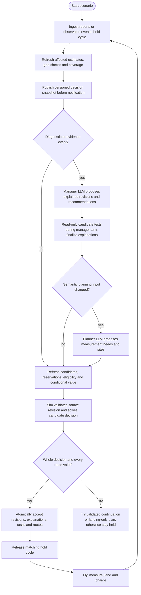
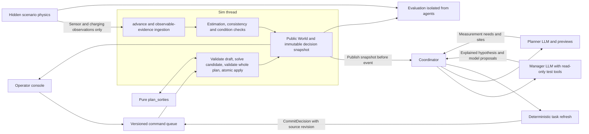
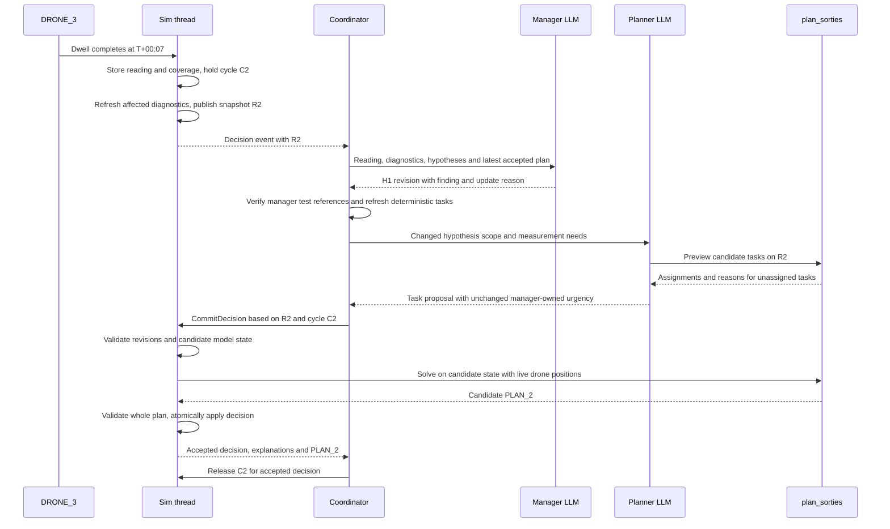
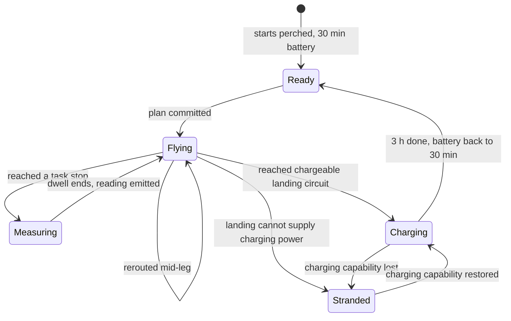

# Measurement planner design

This doc covers how the manager agent's root cause hypotheses turn into drone routes, and how every measurement feeds back into the hypotheses and the routes. It is a design only. Nothing here is implemented yet.

## Premises

- **The map is not a 2D grid.** Drones fly in straight lines between points (`world.distance_km`), so we don't need pathfinding. The problem is choosing which measurement stops each drone visits on one flight. That is a team orienteering problem. Each drone has its own start, an airtime budget, and rewards for unique evidence needs, and a dispatched drone must reach an exact eligible recharge landing before its battery and the scenario deadline expire.
- **Speed turns distance into time.** A leg costs `distance_km / speed + dwell` minutes, and the budget is whatever airtime the drone has left. Range is not a separate constraint because it follows from speed × airtime. With today's 60 km/h (`SPEED_KM_PER_MINUTE = 1.0`), a full flight covers 30 km, which is about the width of the study area.
- **The planning horizon is bounded.** Charging takes 3 hours, and the scenario window is 4 hours. Each of the 5 drones gets at most 2 flights. Solver work has explicit budgets and fallbacks; no millisecond or optimality guarantee is assumed.
- **A flight may visit several stops.** Today `dispatch` flies to one segment midpoint, then lands and charges. A planned sortie may contain one or several measurements, or only a validated landing when recovering from a failure. Assumption: dwell time at a stop counts against airtime.
- **The planner uses public evidence and assumptions.** Landing eligibility uses circuit-specific charging knowledge, hazards, expiry and a declared risk policy, never ground truth.
- **Today there is no route optimization.** The only ranking is [agents.py:85](../src/grid_ops/agents.py), which sorts reachable segments by distance so the drone agent's LLM can pick one. No solver is installed.
- **Today there is no power flow.** `PowerModel` in [grid.py](../src/grid_ops/grid.py) adds external grids and calls `top.unsupplied_buses`, so it only answers whether each line is live or dead. It never calls `runpp`, and the model has no loads, generators or transformers. The dataset has no current, power or load values either.
- **The grid state has to be estimated from samples.** The design adds a made-up ground truth power flow that the system never sees. Drones sample it, a state estimator rebuilds the flows from those samples, and an evaluator scores the rebuild against the truth.

## Validation contract

Four checks have separate owners and results. None may substitute for another.

| Check | Owner and inputs | Trigger | Consequence |
|---|---|---|---|
| Synthetic truth validity | `truth.build`, using hidden AC buses, circuits, injections and scenario switching | Scenario construction and every physical switching or incident that changes the electrical network | Require a finite, converged scenario state under that scenario's specified limits, or reject the scenario transition. Results never enter agent snapshots. |
| Observation and model consistency | `check_grid(model, accepted_readings, estimate)`, using only public evidence and declared model assumptions | Startup; accepted, rejected or reinstated electrical readings; known topology, parameter, prior or sensor-model changes | Publish residual, observability and model-consistency diagnostics before the manager reasons. Mark inconsistent or unsupported conclusions explicitly. |
| Operating condition and local hazards | `assess_condition`, using public readings, uncertainty, inspection coverage and consistency diagnostics | Each relevant electrical or local observation and each relevant model or hypothesis revision | Report measured violations, supported inferences, unresolved hazards and unsupported checks separately. Drive investigation and operator recommendations. |
| Executable drone route | `validate_plan`, using the proposed complete plan, current public decision revision, exact drone state and accepted landing policy | Every autonomous plan or manual dispatch, including retained continuations and landing-only fallbacks | Validate all drones before any mutation. Resume only with a valid continuation for every airborne drone. |

`CheckResult` contains `check_name`, scope, evidence IDs, model revision, method and assumptions, plus `PASS`, `FAIL`, `INDETERMINATE` or `NOT_SUPPORTED` and a concise diagnostic. An empty violation list is never a substitute for a completed check. Observability and bad-data detectability are separate diagnostic fields.

The runtime grid check validates units, circuit references and finite observations, checks active-power consistency and topology assumptions, and assesses available direct voltage and current evidence against the synthetic ratings. Its DC model cannot certify unmeasured voltage magnitudes, reactive flows or all circuit loadings. Those checks return `NOT_SUPPORTED` unless an explicitly defined model and adequate evidence support them. An optional AC candidate screen uses public assumptions and evidence only; convergence shows that a modeled state exists, not that it is the actual state or the true root cause.

Recompute estimation and these diagnostics before the manager sees a changed evidence set. Local-only readings refresh hazard and coverage diagnostics without needlessly solving the unchanged electrical model. At startup, compute a prior-only estimate and label real-measurement observability absent. Route optimization may investigate an uncertain or inconsistent grid; it must not treat that uncertainty as proof that a landing site is chargeable. Grid inconsistency therefore generates diagnostic tasks and constrains claims, while route infeasibility prevents release.

Hidden physical switching first rebuilds and validates the hidden electrical state. It affects public state only through declared telemetry, sensor readings or charging observations. A known switching report separately revises the public topology assumptions and triggers the public checks. There is no direct hidden-truth-to-estimator update.

## Agentic workflow

There are two LLM agents and one route solver. The manager owns diagnostic hypotheses, investigation urgency and operator recommendations. The planner proposes measurement needs and spatial task placement. Deterministic code maintains task eligibility, observation history, reservations and current information values. `plan_sorties` assigns eligible tasks and orders them. Drones execute accepted routes without drone agents.

Every accepted reading batch reaches a manager LLM turn after observation ingestion and affected diagnostics are complete. Hypothesis revisions include the LLM's finding summary and update reason. The coordinator then refreshes deterministic tasks even if the manager changed no hypothesis. It invokes the planner LLM only when the semantic planning input changes, such as hypothesis scope, prediction, sensor availability or an unresolved measurement need. A covariance update or completion of a task normally needs no planner LLM call.



`refresh_tasks(snapshot, hypothesis_proposal, measurement_needs)` runs on startup and after accepted evidence, measurement exclusions, relevant model or hypothesis changes, reservations, expiry and drone availability changes. It removes redundant or invalid candidates, preserves in-progress work, generates baseline and confirmation candidates, and recomputes conditional information values. If an estimate is unavailable, generate labelled topology-based or diagnostic candidates without fabricated covariance gains. Each generated task carries its input revisions. Only semantically changed hypotheses increment `hypotheses_version`; evidence-assessment history has its own IDs.

The planner's last preview does not dispatch or implicitly define the committed task set. Its final structured proposal names measurement needs and sites. The coordinator validates it, merges deterministic candidates, and submits a single decision draft. Preview and final-solve inputs show their revisions and can differ if fresh evidence invalidates the draft.

## Architecture

The sim thread is the only writer of `World`. The coordinator runs the two LLM agents against one immutable `DecisionSnapshot` for each held cycle. Tools are pinned to that snapshot and return its revision. A single writer prevents simultaneous writes; revision checks and atomic acceptance prevent semantically stale decisions.



| Module | Owns |
|---|---|
| `world.py` | Domain records, drone and task state machines, exact transition processing and observable events |
| `truth/` | Explicit synthetic circuit topology, AC state, local hazards, sensor likelihoods and charging physics; never copied into public state |
| `estimation.py` | Reduced public electrical model, accepted-data WLS, uncertainty, observability, detectability and hypothesis-model tests |
| `assessment.py` | Public consistency and operating-condition results, local coverage and evidence-linked recommendation checks |
| `planning.py` | Candidate refresh, information accounting, route optimization and independent route validation; pure, no I/O |
| `sim.py` | Single writer, evidence ingestion, versioned snapshots, commands, holds, atomic decision acceptance and deterministic fallbacks |
| `agents.py` | Coordinator, manager and planner prompts, snapshot-pinned tools, structured drafts and explanations |
| `evaluation.py` | Truth-based scoring and headless policy comparisons; no feedback into agents |
| `app.py`, `map_view.py` | Public hypotheses with findings and reasons, measured coverage, planned routes and unresolved actions; separate evaluation panel |

The manager can call `test_hypothesis` during its LLM turn. Candidate tests operate on the pinned snapshot, and their diagnostics are returned before the manager finalizes its explanation. A changed electrical candidate must be tested before its final revision is proposed. The sim verifies those test inputs or reruns the pure test during acceptance; an explanation referring to obsolete diagnostics is rejected for regeneration.

## Hypotheses and physical predictions

A hypothesis is a falsifiable claim with a spatial scope, supporting and contradicting evidence, a qualitative assessment (`UNTESTED`, `SUPPORTED`, `REFUTED` or `INCONCLUSIVE`), investigation priority, and predicted observations. Priority 1 to 5 expresses investigation urgency, not probability. No numeric posterior is claimed until a likelihood model is defined and calibrated. Several hypotheses may coexist, and one reading may inform several of them.

Each `Prediction` names a measurement kind, circuit or covered interval, expected result or bounded range, required operating conditions, and what would support, contradict or fail to distinguish the claim. The manager must record when existing sensors cannot distinguish alternatives. The system does not manufacture confidence from narrative fluency.

| Hypothesis class | Required test | Limits |
|---|---|---|
| Electrical topology or parameter explanation | A `ModelChange` identifying the affected circuits, switches or declared parameters; recompute the candidate estimate, observability and residual diagnostics against the same accepted observations and priors | An open line, bad sensor and wrong impedance are competing explanations. A lower fitted residual alone is not proof; report degrees of freedom, assumptions and indistinguishable candidates. |
| Local clearance, motion or thermal hazard | Predicted local observations and sensor detection conditions over a `SpanRef`, the segment ID plus start and end offsets | A clean reading outside the suspect interval is irrelevant. Low load makes a clean thermal reading inconclusive. Normal power flow cannot refute a mechanical hazard. |
| Baseline flow state unknown, H0 | Remaining observable-flow and uncertainty gaps in the current reduced model | H0 is an investigation objective, not a physical fault or an assertion of grid health. |

`test_hypothesis(candidate, decision_snapshot)` returns evidence-linked `CheckResult`s and predicted discriminating measurements. It never reads hidden truth. Electrical candidate testing runs when such a candidate is created or its physical effect, supporting evidence or operating model changes. Local tests run on relevant local or operating-condition evidence. Unsupported physical predictions remain `NOT_SUPPORTED`; the hypothesis can remain an explicitly untested investigation target, but cannot be promoted to an established physical explanation.

Candidate electrical models are evaluated in isolation. The manager proposes a model revision with its hypothesis revision; the sim accepts both together only after checks and evidence references are valid. A diagnostic hypothesis does not silently change the network used by the estimator. If several topologies remain possible, keep the accepted operating assumption explicit, label observability conditional on it, and test route endpoints against all retained plausible energization states.

### Explained hypothesis revisions

Every creation, assessment change, scope change, prediction change, priority change or retirement of a hypothesis requires an immutable `HypothesisRevision`. The manager's existing LLM call must produce both `finding_summary` and `update_reason` before acceptance. A deterministic reading summary or a later free-text chat message does not satisfy this requirement.

The revision records the decision and source snapshot, hypothesis ID, full before and after values, actual trigger event IDs, all contributing evidence IDs, and the latest measurement IDs and timestamps in that evidence. Every measurement-triggered revision must identify the current triggering batch and explicitly state what its latest observation added; older supporting evidence cannot be substituted for the new finding. `finding_summary` states in natural language what those measurements revealed, including values, units, location and detection conditions. `update_reason` explains why that finding changed this hypothesis in this particular way, or why an earlier measurement remains relevant to a non-measurement-triggered change. It distinguishes assessment from urgency, names contrary evidence and alternatives, and states remaining uncertainty. Reference the estimator and physical-test results used in the explanation.

For a simultaneous batch, retain all latest measurements tied at the latest timestamp and distinguish their joint contribution from older evidence. For startup, cite reports and explicitly say no drone measurement exists yet. For operator-driven updates, name the operator event as the trigger and link the latest relevant measurement if one exists; never invent a new measurement. An unchanged hypothesis receives an evidence assessment in the manager turn record but no new semantic revision.

`CommitDecision` validates the revision schema, evidence references, source revision, before values and numerical claims against stored readings. It cannot prove the LLM's causal interpretation correct; physical tests, evidence links and reviewer-visible uncertainty make that interpretation inspectable. The sim accepts the hypothesis state, its explanation and any related model changes in one transaction. Missing or invalid explanations reject the proposed update. Retrying the same decision ID is idempotent.

## Example request

This is a hypothetical incident-mode trace. IDs are from the dataset; readings, priorities, times and routes are illustrative rather than solver output. All six reports are available at startup, even though their reported timestamps differ.

Initially H1 investigates vegetation in the SYN_REPORT_02 area, priority 3. H2 investigates a hot joint and H3 investigates abnormal motion, both priority 3. H4 investigates the reported protection event and its uncertain relationship to LINE_024's confirmed precautionary switching, priority 5. H0 tracks reduced-model flow-estimation gaps. PLAN_1 sends DRONE_3 to a clearance task on LINE_058.



H1's stored LLM explanation, with H1-alt creation explained separately, reads for example:

> At T+00:07, DRONE_3 measured vegetation 0.4 m from the lowest conductor at the sampled location on LINE_058. This supports a local vegetation hazard and raises inspection priority from 3 to 5 under the scenario's 0.5 m clearance escalation threshold. It does not establish conductor contact, a cause of the protection event, or safe clearance outside the inspected interval. The finding does not independently implicate LINE_064. That segment remains an untested alternative only because it crosses the original report area.

The 0.5 m threshold is a synthetic exercise policy, not an operational safety standard. A numerical violation can justify an inspection recommendation before the rest of the grid is observable. H1 narrows to the measured local vegetation claim and becomes `SUPPORTED`. A separately created H1-alt retains the original report-area alternatives as `UNTESTED`, including LINE_064. Both changes have explained revisions; the local finding is not generalized to the broad alternatives.

If hypotheses remain unchanged, skip unnecessary planner LLM interpretation, but still refresh eligibility, reservations, covariance-based candidates and values before solving. An unassigned urgent task is reported to the manager and operator; the planner cannot raise its urgency merely to make the preview assign it.

## Events and invalidation

The sim processes all observable events at one simulation timestamp as one decision batch. It holds the clock, ingests observations, refreshes affected diagnostics and publishes the immutable snapshot before notifying the coordinator. `hold` is separate from the operator's pause toggle. Decision time is free in the exercise; reset the wall-time baseline on release so LLM latency is not charged as flight time.

| Event | Public estimation and checks | Manager LLM | Deterministic task refresh | Planner LLM | Route solve and acceptance |
|---|---|---|---|---|---|
| Startup with reports | Prior-only estimate, model validation, report and initial charging observations | Initial explained hypotheses | Yes | Initial measurement needs | Yes |
| Electrical reading batch | Update accepted observations, estimate, observability, detectability and condition checks | Yes, including a no-change evidence assessment | Yes | Only changed semantic planning input | Yes |
| Local reading batch | Update coverage, detection conditions and hazard checks; electrical solve only if inputs changed | Yes | Yes | Only changed semantic planning input | Yes |
| Reading rejected or reinstated | Rebuild accepted-data estimate and all dependent diagnostics | Yes | Yes, including confirmation candidates | If measurement needs change | Yes |
| Known switching, model or prior change | Invalidate contradicted operational evidence immediately; check the current accepted model and test any staged replacement model, references and diagnostics | Yes; explain any hypothesis or model proposal | Yes | If measurement needs change | Yes |
| Proposed hypothesis or urgency change | Run affected hypothesis tests; candidate model changes refresh candidate diagnostics | Required explained revision | Yes | If semantic input changes | Yes |
| Drone ready | No unchanged grid solve; refresh availability | No, unless an unresolved diagnostic is also present | Yes | Normally no | Yes |
| Expected successful landing or charge telemetry | Update the observed circuit's charging evidence and occupancy | No unless evidence conflicts with expectations | Refresh affected eligibility and reservations | Normally no | Only if another route or endpoint eligibility changes |
| Stranding, lost charging power or contradictory voltage | Invalidate affected charging evidence; refresh electrical checks only from observable information | Yes | Yes | If measurement needs change | Yes |
| Evidence expiry | Invalidate affected knowledge and endpoint eligibility; retain historical readings | If diagnosis or a claim changes; not for an availability-only expiry | Yes | If new measurements are needed | Yes |
| Manual dispatch or operator evidence | Ingest evidence if provided; validate against the same public model and policies | If diagnostic facts or hypotheses change | Yes | If new measurement needs arise | Yes; manual requests cannot bypass acceptance |
| T+04:00 | Freeze scored observations, record unresolved checks and finish any permitted zero-time transitions | Final report, with explained revisions only if hypotheses change | Cancel unstarted work | No | Require landing by the deadline; a pre-existing infeasible state stays held for explicit intervention |

A physical incident inside `Simulation._truth` is not itself public evidence. Validate the hidden transition, then emit only declared observable consequences such as telemetry, a sensor reading or charging interruption. Hidden event IDs and evaluator scores never enter manager messages.

The dependency key includes evidence selection, operating epoch, electrical model and priors, sensor model, hypothesis semantics, coverage, task reservations, landing policy and drone state. Each output records the subset it depends on. Changing an explanation alone does not invalidate task geometry; changing covariance does invalidate information values. Compare full semantic hypothesis values before bumping `hypotheses_version`.

A solve reporting unassigned urgent work produces one deduplicated `PlanningBlocked` notification per unchanged cause, not an infinite manager/replan loop. The manager can explain the limitation, propose a new measurement need or recommend field inspection. It cannot make an infeasible route valid by renaming its urgency.

### Failure policy

Agent exceptions, malformed explanations, stale drafts, failed estimation, solver timeout, infeasibility and commit rejection have distinct recorded outcomes. No path releases the clock unconditionally. A failed LLM turn accepts no proposed hypothesis changes. Existing tasks may be reused only after refresh against current evidence and reservations.

Try the trimmed current continuation only if it still passes all route checks. Otherwise attempt a landing-only plan for every airborne drone under the accepted landing policy. An estimator failure marks the estimate unavailable and its conclusions unsupported; it does not invalidate independently supported landing evidence. If no valid continuation exists, keep the cycle held and expose the affected drone, constraint and required operator action. A coordinator watchdog can invoke the same deterministic fallback; it cannot invent explanations or silently accept a risk-policy change.

A route failure must not suppress an urgent diagnostic finding. After validating a manager response's schema, source and evidence links, publish an immutable `PendingDiagnosticNotice` on a separate public diagnostic channel before attempting route acceptance. It carries the proposed revisions, LLM finding and reason, independently checked recommendation, source cycle and revision, and a clear `PROPOSED_NOT_ACCEPTED` status. The UI shows it immediately beside the raw observation, including any route-blocking reason. This notice does not change accepted hypotheses, topology, tasks, routes or the decision dependency revision, and cannot authorize release. Subsequent notices link acceptance, rejection or supersession without erasing history. Accepted `World.manager_turns` link the corresponding notice. If no manager response is valid, the already-published direct condition diagnostic still shows the measured violation without an invented LLM explanation.

Each hold has a unique `cycle_id`. Only `Release(cycle_id, accepted_decision_id)` for that cycle's accepted decision can resume it. Late commands and releases from older cycles are rejected. Retrying a previously accepted command ID returns its stored result without replaying its effects.

## Replanning rules

| Drone state | Participation | Effective start | Remaining budget |
|---|---|---|---|
| Ready | Wait or start one sortie | Exact current perch at current clock | Current full battery |
| Flying | Replan the unflown suffix | Exact airborne position at current clock | Current `battery_min` |
| Measuring | Preserve locked attempt and replan its continuation | Exact stop at dwell completion | Current battery minus remaining dwell |
| Charging | Fixed occupancy until the required charge completes | Not a solver vehicle | No early departure |
| Stranded | Fixed occupancy until charging capability returns and full charging completes | Not a solver vehicle | No unauthorized relaunch |

A measurement in progress finishes unless a recorded physical interruption makes it fail. Dwell and recharge are never shortened by a replan. Keep completed and failed work in history. Trim and revalidate a current route before using it as an incumbent; CP-SAT receives valid hints, not a guarantee of improving local search. Compare returned candidates under the same current objective and retain a still-valid continuation if it scores better. Switching is a lower objective tier than unique diagnostic benefit and cannot block a necessary feasibility change.

All dispatched drones must land by T+04:00 and then complete the required 180-minute recharge before any later departure. A Ready drone with no useful feasible sortie stays perched without a fictitious flight. Replanning does not move charging or stranded drones, erase their occupancy or reset their timers. An interrupted charge starts over only when actual charging capability returns.

### Task and observation lifecycle

A site has a stable registry ID and exact unrounded coordinates. Serialized local offsets use integer millimetres so identity does not depend on formatting a floating-point value. For electrical ranking, map all offsets observing the same circuit aggregate to one canonical observation group; distinct spatial site IDs do not create distinct state equations.

`PENDING -> RESERVED` occurs only when an accepted plan assigns the attempt to one drone. `RESERVED -> MEASURING` occurs on arrival. Completion stores one immutable reading and marks the attempt `COMPLETED`. Replanning may release an unstarted reservation back to `PENDING`, cancel it with a reason, or reassign it atomically. A failed attempt records `FAILED`; confirmation creates a new attempt rather than rewriting the failed or completed one. Histories and completed-task metadata are never removed by a replacement open-task list.

A `MEASURING` attempt is locked to its drone until completion or a recorded physical interruption. It is excluded from the optional solver set and cannot be assigned again. For that drone's continuation, start at its current stop at `world.clock + remaining_dwell`, with `battery_min - remaining_dwell`. Route acceptance includes the locked dwell and suffix exactly once. Even if its hypothesis is retired, the in-progress observation finishes; its subsequent interpretation may be inconclusive. Outstanding reservations and their dependencies are retained in each decision snapshot.

A repeat task requires a purpose and links its earlier reading or diagnostic. Its noise independence is assessed by the sensor model; repeated measurements do not automatically provide new structural rank or remove shared calibration bias. Full reading metadata includes position, kind, circuit payload, epoch, covariance and detection conditions, so a later explanation remains meaningful after the task leaves the open set.

### Route acceptance invariants

Every accepted plan accounts for each `Ready` drone as either waiting at its present perch or taking a sortie, and every `Flying` or `Measuring` drone with exactly one executable continuation. Charging and stranded drones retain their state and occupy their actual perches; they are not silently offered as available vehicles. A ready drone may wait without taking off, consuming battery or restarting a charge.

Validate site and circuit existence, offset bounds, sensor capability, unique attempt ownership, locked work, exact landing geometry, current landing policy and freshness through predicted arrival. Known hazards invalidate their affected landing intervals. Check battery and remaining dwell, every stop's completion time, and landing by T+04:00. There is no hidden post-deadline flight in evaluation. A route-only fallback must pass the same checks.

The landing-site candidate set includes sampled points, existing drone perches, task locations, and nearest eligible projections from each current drone position and each candidate final measurement stop onto every reachable segment. All have explicit circuit identity. Sampling alone must not create a false inability to land. Use a conservative common seconds model: ceil each nonzero travel and dwell duration, floor remaining battery seconds, and use the same durations in optimization, validation and simulation.

The exercise allows at most one drone at a registered landing point and circuit. Include charging and stranded occupancy, reserve planned landing occupancy through the next departure or scenario end, and conservatively exclude a point whose occupant has no accepted departure. Separate exact points on a long line may host separate drones; this is a declared simplified occupancy model. If route timing is not modeled precisely enough to prove a handover, keep that point unavailable rather than double-book it.

## Data shape

```python
class Measurement(StrEnum):
    VOLTAGE_PRESENCE = "voltage_presence"   # E-field: is the line live?
    CURRENT = "current"
    CONDUCTOR_TEMP = "conductor_temp"       # hot joints, only visible on a loaded line
    CLEARANCE = "clearance"                 # sag / vegetation distance
    MOTION = "motion"                       # galloping, clashing

DWELL_MINUTES = {VOLTAGE_PRESENCE: 1, CURRENT: 2, CONDUCTOR_TEMP: 3, CLEARANCE: 3, MOTION: 4}

@dataclass(frozen=True)
class Hypothesis:               # manager → sim → planner
    id: str
    claim: str
    scope: tuple[SpanRef, ...]
    assessment: HypothesisAssessment
    lifecycle: HypothesisLifecycle
    priority: int
    prediction_ids: tuple[str, ...]
    supporting_evidence_ids: tuple[str, ...]
    contradicting_evidence_ids: tuple[str, ...]
    model_change: ModelChange | None

@dataclass(frozen=True)
class HypothesisRevision:
    id: str
    decision_id: str
    source_revision: SnapshotRevision
    hypothesis_id: str
    before: Hypothesis | None
    after: Hypothesis
    trigger_event_ids: tuple[str, ...]
    contributing_evidence_ids: tuple[str, ...]
    latest_measurement_ids: tuple[str, ...]
    diagnostic_ids: tuple[str, ...]
    finding_summary: str
    update_reason: str
    remaining_uncertainty: str

class TaskStatus(StrEnum):
    PENDING = "pending"
    RESERVED = "reserved"
    MEASURING = "measuring"
    COMPLETED = "completed"
    CANCELLED = "cancelled"
    FAILED = "failed"

@dataclass(frozen=True)
class MeasurementTask:
    id: str
    site_id: str
    hypothesis_ids: tuple[str, ...]
    point: LinePoint
    kind: Measurement
    urgency: int
    benefit_group_ids: tuple[str, ...]
    purpose: str
    source_revision: SnapshotRevision
    status: TaskStatus
    assigned_drone_id: str | None
    repeat_of_reading_id: str | None

@dataclass(frozen=True)
class CircuitFlow:
    circuit_id: str
    current_a: float
    p_mw: float
    q_mvar: float

@dataclass(frozen=True)
class Reading:
    id: str
    task_id: str
    site_id: str
    drone_id: str
    point: LinePoint
    kind: Measurement
    clock: float
    operating_epoch: str
    payload: MeasurementPayload
    sensor_model_revision: str
    covariance_ref: str
    detection_conditions: DetectionConditions
    summary: str

@dataclass(frozen=True)
class Sortie:
    drone_id: str
    stops: tuple[str, ...]      # task ids, in order
    available_from: float
    locked_dwell_minutes: float
    landing: LandingSite
    landing_clock: float
    airtime_minutes: float

@dataclass(frozen=True)
class Plan:
    id: str
    source_revision: SnapshotRevision
    sorties: tuple[Sortie, ...]
    waiting_drone_ids: tuple[str, ...]
    unassigned: tuple[UnassignedTask, ...]
    landing_policy_revision: str

def plan_sorties(inputs: PlanningInput, current: Plan | None) -> PlanningResult: ...
```

## State model

Two fields answer "where is the drone, and how much flight does it have left". They are `Drone.position` and `Drone.battery_min`. Both are exact at `world.clock`, and `advance` is the only code that changes them.

### Positions on the line

Today every flight goes to a segment midpoint. That is a poor stand-in for a position. LINE_024 is 26.8 km long, so its midpoint is about 13 km from either end, and 13 of the 64 segments are longer than 5 km (measured from `grid_segments.geojson`). The design replaces midpoints with points along the line.

```python
LonLat = tuple[float, float]

@dataclass(frozen=True)
class LinePoint:
    """A point on a mapped line, measured along its path from from_node."""
    segment_id: str
    offset_km: float

@dataclass(frozen=True)
class LandingSite:
    point: LinePoint
    circuit_id: str

# Network gains:
#   position_of(point: LinePoint) -> LonLat
#   nearest_point(segment_id: str, near: LonLat) -> LinePoint
#   sample_points(segment_id: str, every_km: float, inside: Area | None) -> list[LinePoint]
```

- **Local tasks inspect bounded intervals.** Place stops no more than 1 km apart for the assumed 0.5 km along-line footprint when complete coverage is intended. Include clipped report-area boundaries and segment endpoints. A 2 km spacing would leave 1 km blind intervals and is insufficient for clearing a corridor.
- **Landing candidates use a separate discretization.** A coarse 2 km landing grid is augmented by exact task sites, current perches and nearest feasible projections. Eligibility uses circuit-specific chargeability, hazards, expiry and occupancy. Local inspection spacing is independent of landing-point sampling.
- **Electrical and local evidence have different scopes.** `CURRENT` and `VOLTAGE_PRESENCE` use the declared terminal-equivalent abstraction for each circuit. Local measurements support only their actual inspected interval and stated detection conditions. Their range does not turn a local negative into evidence about the entire line.

### Local coverage and negative evidence

For each accepted local reading, store the nominal footprint clipped to its segment, the actual inspected subintervals, sensor kind, epoch, condition flags and evidence ID. Compute union coverage by interval arithmetic, not by multiplying stop count by range. Overlapping footprints contribute new coverage only for their difference from existing valid coverage. Report occluded and uninspected intervals explicitly.

A clean reading contradicts a local prediction only where that sensor's likelihood model provides adequate detection probability under the recorded conditions. The synthetic local model uses Gaussian clearance error with 0.05 m standard deviation, temperature error with 1 degree Celsius standard deviation and motion-amplitude error with 0.02 m standard deviation. Each payload reports the most adverse quantity over its actually inspected interval. Environmental baselines and excitation flags are part of the observation model. The fixture defines likelihoods for the relevant threshold events; use a 95% detection requirement before treating a qualified negative as evidence against the scoped claim.

A single qualified negative can lower support but does not automatically refute an entire report-area hypothesis. Refutation requires the hypothesis's declared spatial and operating-condition test coverage. Thermal defect tests require current above the fixture's excitation threshold; intermittent-motion tests require a qualifying gust window. Insufficient excitation or visibility yields an inconclusive result and an explicit follow-up need. Retire only the tested scoped claim, retaining untested alternatives with explained revisions.

### Drone state machine

```python
@dataclass(frozen=True)
class Stop:
    task_id: str
    point: LinePoint
    position: LonLat            # resolved once with network.position_of

@dataclass(frozen=True)
class Route:
    stops: tuple[Stop, ...]     # task stops still to visit, in order
    perch: LandingSite
    perch_position: LonLat

    @property
    def target(self) -> LonLat:
        return self.stops[0].position if self.stops else self.perch_position

@dataclass(frozen=True)
class Ready:
    perch: LandingSite

@dataclass(frozen=True)
class Flying:
    origin: LonLat
    departed: float
    arrives: float              # departed + conservative rounded leg seconds / 60
    route: Route

@dataclass(frozen=True)
class Measuring:
    stop: Stop
    until: float
    route: Route                # what comes after this stop

@dataclass(frozen=True)
class Charging:
    perch: LandingSite
    until: float

@dataclass(frozen=True)
class Stranded:
    perch: LandingSite

DroneState = Ready | Flying | Measuring | Charging | Stranded

@dataclass
class Drone:
    id: str
    speed_km_per_min: float
    position: LonLat            # exact at world.clock
    battery_min: float          # airtime left, exact at world.clock
    state: DroneState
```



- **Battery drains only in `Flying` and `Measuring`,** at one minute per sim minute. It goes back to 30 only on `Charging → Ready`. Charging is all or nothing, as the rules say, so an interrupted charge starts over.
- **A route names an exact landing point and circuit.** This makes the intended endpoint explicit but does not prove reachability or chargeability. `validate_plan` checks those conditions separately.
- **Acceptance validates every route before any mutation.** Recalculate flight, locked dwell, task dwell and landing time from authoritative coordinates, speed and current battery. A rejected sortie rejects the complete candidate decision without changing any drone. Do not trust the solver's reported airtime.
- **Position follows the common geometry and time model.** For a positive-duration leg, interpolate from `origin` to `route.target` using elapsed flight fraction. A zero-distance arrival is processed immediately. At stops and landing sites, resolve the exact registered point. Geometry error is bounded by the configured route-validation tolerance rather than assumed negligible.

### World and ground truth

`World` holds only public observations, declared assumptions and derived results. Agent tools read a pinned immutable `DecisionSnapshot`, while the UI can read the latest public snapshot. The current implementation's `World.energized` moves into hidden `Simulation._truth` and is never copied into either public view.

```python
@dataclass
class World:                    # what the operator knows; snapshots of this reach the agents
    clock: float
    drones: dict[str, Drone]
    circuit_knowledge: dict[str, CircuitKnowledge]
    chargeability: dict[str, Chargeability]
    fault_assessments: dict[str, FaultAssessment]
    coverage: tuple[InspectionCoverage, ...]
    hypotheses: dict[str, Hypothesis]
    predictions: dict[str, Prediction]
    measurement_needs: dict[str, MeasurementNeed]
    benefit_groups: dict[str, BenefitGroup]
    revision: SnapshotRevision
    operating_epoch: str
    model: ElectricalModel
    hypotheses_version: int
    hypothesis_revisions: tuple[HypothesisRevision, ...]
    manager_turns: tuple[ManagerTurnRecord, ...]
    tasks: dict[str, MeasurementTask]
    readings: dict[str, Reading]
    reading_dispositions: tuple[ReadingDisposition, ...]
    estimate: GridEstimate | EstimateUnavailable
    diagnostics: tuple[CheckResult, ...]
    recommendations: tuple[Recommendation, ...]
    plan: Plan | None
    log: list[LogEntry]

class Physics(Protocol):        # implemented by grid_ops.truth; passed into advance
    def is_live(self, circuit_id: str) -> bool: ...
    def is_chargeable(self, landing: LandingSite) -> bool: ...
    def sense(self, point: LinePoint, kind: Measurement, clock: float,
              observation_key: str) -> SensorSample: ...
```

The physics callback produces a timestamped `SensorSample` from hidden state and the declared sensor model. The sim attaches task, site and drone identity when constructing the immutable `Reading`; sensing does not need access to planner metadata. An unpowered or lightly loaded line supplies insufficient thermal excitation to exclude a hot joint. Retained heat and environmental effects follow the local sensor model rather than an assumption of instant cooling.

Observations update circuit knowledge, chargeability and local coverage through the ingestion rules below. The manager proposes evidence-linked fault assessments and model changes, rather than replacing operational observations with a combined line-status label.

### Energization, chargeability and inspection state

Replace the combined `LineStatus` enum with independent public records. `CircuitKnowledge` is keyed by the explicit circuit ID and stores energization (`UNKNOWN`, `LIVE`, `DE_ENERGIZED` or `CONFLICTED`), evidence IDs, observation time and operating epoch. A segment's displayed status is derived from its circuits; one live circuit does not establish that every circuit on a shared tower is live.

`FaultAssessment` links hypotheses and local `SpanRef`s to their evidence and qualitative assessment. `InspectionCoverage` records which intervals each sensor actually inspected, under what operating conditions and in which epoch. Clearing a local suspicion changes neither energization nor chargeability.

`Chargeability` is separate from voltage presence. It is `CONFIRMED`, `UNKNOWN`, `UNAVAILABLE` or `CONFLICTED` for an exact landing circuit, with evidence and expiry. The synthetic sensor model defines sufficient charging power as a live circuit with current at least `I_CHARGE_MIN_A = 5 A`; this threshold is an exercise assumption, not a claim about real charging hardware. A measured voltage and current interval must support those conditions, or an observed successful charging handshake can confirm them directly. Hidden physics applies the same declared capability rule to actual charging. Initial perches have an explicit successful-handshake observation and full batteries, not an unexplained blanket assumption about all lines.

Observation ingestion is deterministic and precedes the manager. A high-quality voltage result incompatible with `LIVE` immediately removes that circuit from eligible perches. Simultaneous or unresolved contradictory sources yield `CONFLICTED`, not last-writer-wins. A newer direct measurement supersedes an older report about the current state, but retains the discrepancy and triggers a model or epoch review. Zero current alone never proves de-energization. The manager may interpret causes but cannot overwrite direct observations with a bare status label.

For this static-within-epoch exercise, operational evidence is fresh until a known switching or model-change event invalidates it, or until a configurable 30-minute evidence lifetime expires. `EvidenceExpired` is a scheduled event, even when no drone reading occurs. A planned landing must occur before its supporting chargeability evidence expires. A new voltage or current measurement does not extend unrelated evidence. Successful charge telemetry renews only the observed circuit's chargeability while the drone remains perched.

Default landing policy requires a fresh `CONFIRMED` chargeable circuit, no known landing hazard, and no contradiction among retained plausible operating models. `UNKNOWN`, expired or conflicted candidates may appear in previews as investigation options but are not executable recharge endpoints. A scenario may explicitly enable uncertain endpoints with a documented risk penalty and operator-visible rationale; this is a separate policy setting and cannot override known unavailability or a known landing hazard. Route feasibility always states which policy was applied.

### Time and simultaneous transitions

`advance` updates position and battery exactly to the earliest arrival, dwell completion, charge transition, evidence expiry, any scheduled hidden physical transition, declared observable scenario event or exercise deadline. Hidden transitions participate in the internal time calculation even when they produce no immediate public observation; apply them at the exact timestamp and continue advancing without a public event or hold unless an observable consequence occurs.

Before publishing an event batch, process all transitions due at that timestamp to a fixed point, including zero-distance arrivals and co-located stops.

At a timestamp, first apply and validate scheduled hidden physical changes, then resolve charging interruptions and arrivals, then take all due sensor samples from that resulting physical state, then complete charge/availability and expiry transitions. A qualified fresh observation at the exact expiry instant replaces expiring evidence before eligibility is assessed. Stable IDs break ties within these phases.

Observations at the same time are assessed together; hidden physical epoch provenance stays inside the sim and evaluator. Public readings carry only their observed timestamp and the evidence-compatibility epoch established by public reports or observed inconsistency, never a hidden incident ID. When a change becomes known later, retain raw readings and explicitly revise their epoch dispositions instead of pooling incompatible states. Reject a transition cycle that cannot make progress instead of looping forever.

Zero-distance travel completes without interpolation or battery drain. Otherwise interpolate the flight position only for a strictly positive leg duration. Use one distance model in both optimization and acceptance. For this synthetic exercise, great-circle flight length with a documented local interpolation approximation is acceptable; verification compares its maximum geometry error against the configured distance tolerance.

```text
advance(world, physics, until)
  repeatedly select the next internal or observable transition time, no later than until
  move all drones and drain flight or measurement battery to that time
  process all due transitions to a fixed point
  emit one batch containing every observable event at that time
  return after an observable batch, or when until is reached
```

### Simulation and decision transaction

`SnapshotRevision` contains a monotonic public world sequence and the evidence-selection, operating-model, sensor-model, hypothesis-semantic, task-reservation, policy and drone-state revision IDs. `DecisionSnapshot` contains a deep-frozen public world, its revision, `cycle_id`, trigger events and clock. It contains no truth or evaluation fields. The UI may read the latest public snapshot; all tools in one agent turn read its pinned decision snapshot.

Commands are `Start`, `SubmitObservation`, `RequestReadingDisposition`, `RequestModelChange`, `RequestManualDispatch`, `CommitDecision`, `Release`, `SetPaused` and `Log`. Scenario control has a separate `SetInService` command inaccessible to agent tools. It changes and validates hidden physics and produces only declared observations. The old independently mutating `SetBelief`, `SetHypotheses`, `SetTasks` and bare `Replan` commands are removed. `RequestModelChange` stages a candidate in the next decision snapshot and cannot change the accepted electrical model merely by entering the queue. Known switch evidence invalidates affected operational assumptions immediately, while its proposed electrical-model replacement is tested and accepted through `CommitDecision`. Operator hypothesis edits are proposals that require a manager-generated explained revision before acceptance.

`DecisionDraft` contains a unique decision ID, cycle and source revision, explained hypothesis revisions, candidate model changes, recommendations and a final measurement-needs/task proposal. Every command has a unique command ID and stored outcome for retry deduplication. No-op hypothesis proposals retain the semantic version while the manager's evidence assessment is still appended to turn history.

```text
on an observable batch or state-changing operator command
  hold or supersede the current cycle
  persist observations, dispositions and direct operational consequences
  invalidate affected assumptions and refresh diagnostics
  create the new immutable DecisionSnapshot
  publish it before enqueueing its DecisionEvent

on CommitDecision(command)
  verify command identity, active cycle and exact source revision
  build a private candidate world from the current held world
  validate explained revisions, before values, evidence and recommendations
  publish a proposed diagnostic notice without changing accepted decision state
  test any proposed model and hypothesis changes on candidate inputs
  refresh affected candidate estimates, diagnostics and tasks
  preserve ongoing measurement reservations and trim completed work
  solve candidate routes using current exact drone states
  validate the complete decision and all routes without mutating live state
  if any check rejects the draft, discard the candidate and report the cause
  otherwise atomically replace affected public state and executable routes
  publish the accepted decision snapshot and return its ID and plan

on Release(cycle_id, accepted_decision_id)
  require the active cycle and its still-current accepted decision
  reset the real-time baseline, then clear hold unless operator-paused
```

An operator command during an LLM turn either is read-only or creates a newer cycle and revision; old drafts cannot commit. A successful decision includes its explanations, hypothesis state, model revision, tasks, reservations, recommendations and plan together. Observations already ingested remain durable if that proposal fails. A valid deterministic fallback can accept a route-only decision with unchanged hypotheses and no invented revision. If a failure has no validated fallback, remain held as specified in the failure policy.

## Power flow ground truth and scenarios

The synthetic electrical network is an answer key for the exercise, not a reconstruction of Bavaria's actual electrical connectivity. A shared mapped substation or a mixed-voltage tag does not prove a busbar connection or transformer. Independent sources per mapped component, station interconnections, ratings and load assignments below are explicit scenario assumptions. They are public modeling assumptions; the realized injections, randomized impedances and fault locations are hidden.

Two named modes prevent a benchmark fixture from contradicting its own operator brief.

| Mode | Public inputs and hidden state | Purpose |
|---|---|---|
| `healthy_benchmark` | Counterfactual no-incident fixture. Its generated brief explicitly states every circuit is initially in service and removes SYN_REPORT_03's confirmed switching assertion; storm reports are marked unused synthetic background | Compare reduced-model reconstruction policies under a controlled operating point |
| `incident_demo` | Original six reports, all available at startup; LINE_024 initially switched off as reported; at least one local vegetation hazard, one qualified clean observation and one inconclusive thermal observation | Demonstrate evidence-driven diagnosis, explained revisions, operator actions and route adaptation |

The incident brief distinguishes the recorded protection event from LINE_024's precautionary switching. Their causal relationship is unknown. No scenario labels the protection event as a confirmed trip on LINE_024. The manager sees neither fault placement nor truth-based scores.

`truth.build(network, scenario_config, seed)` constructs the explicit circuit registry described in the electrical reduction, then builds the AC network.

| Element | Rule |
|---|---|
| Buses and transformers | One bus per mapped node and voltage level. Synthetic mixed-voltage connections use explicit 380/110 kV transformers with recorded rating, tap, impedance and phase shift. The nominal reduction assumes zero phase shift; deviations require a model-discrepancy case. |
| Circuits | One physical AC branch per registry circuit, preserving its voltage and ID. Do not multiply the source circuit count independently at every voltage. Catalogue impedances times length vary by seeded factors within plus or minus 10%. |
| Supply | Choose the highest-voltage boundary endpoint per initial component, breaking ties by node ID, as its declared external source. If no boundary exists, use a declared substation source; COMPONENT_07 uses SUBSTATION_03. Reject source-less initial components. Other boundaries have bounded seeded P and Q exchanges. |
| Loads and generation | Seeded 110 kV substation and terminal loads of 10 to 60 MW at power factor 0.95; selected substations receive 5 to 40 MW of renewable generation. Junctions and intermediate nodes have no external injection. |
| Operating islands | Recompute after switching. An island without a declared grid-forming source is de-energized and recorded explicitly; do not create a hidden replacement slack to conceal an outage. Balance and solve each energized island. |
| Validation | Require finite results and convergence for energized buses, valid power balance, explicit unsupplied islands, and line and transformer ratings. The healthy fixture requires 0.95 to 1.05 pu voltage and line and transformer loading below 60%. Incident fixtures declare their expected violations; they do not silently rescale an intended fault away. |
| Bounded construction | Try at most 100 seeded operating points, adjusting loads, generation and boundary exchanges within their declared bounds together. Validate initial charging capability at the chosen starting circuits. If none satisfies the fixture constraints, return `ScenarioInfeasible` with diagnostics. Reducing loads alone is not a guaranteed repair. |

`TruthState` stores scenario and epoch IDs; per-circuit P and Q at both terminals, both terminal currents, losses and rating; per-voltage-bus voltage; explicit transformer results; source and island status; local fields; and scheduled incidents. It implements the `Physics` protocol. Only the sim, evaluator and truth package may import it. Keep the banned-import lint rule and also test that public snapshots, tools, logs, diagnostics and command results contain no hidden scenario fields. Import restrictions alone do not prove data-flow isolation.

### Local incident fixtures

A `LocalField` is indexed by circuit and along-line interval and contains clearance, environmental temperature, thermal defect excess, and motion amplitude during qualifying gust windows. Its values and event times are scenario inputs, separate from the AC steady-state calculation. A hot-joint excess may use a declared `k * I_squared` relation; absence of excess at low current cannot exclude the defect. Environmental temperature and retained heat remain present without load.

The required incident fixture places vegetation on a clipped interval of LINE_058 with minimum clearance 0.4 m. Normal comparison intervals have minimum clearance 2 m. It includes a hot-joint candidate on LINE_029 with 15 degrees Celsius excess when circuit current exceeds the synthetic 20 A excitation threshold, plus a low-load reading whose excitation flag makes it inconclusive. Motion fixtures use 0.30 m abnormal and 0.05 m comparison amplitudes during recorded gust windows. Local threshold examples are clearance below 0.5 m, thermal excess above 10 degrees Celsius under adequate load, and motion above 0.20 m under a qualifying gust. All are exercise policies, not operational standards.

Apply the local Gaussian errors and visibility flags from the sensing section. Derive threshold-event likelihoods from those distributions and field conditions, rather than assuming perfect detection inside the radius. A separate correlated-error fixture tests repeat observations. A scripted public switching report followed by incompatible qualified voltage evidence exercises deterministic invalidation and the manager's explained response. The incident integration test must include positive, qualified negative, inconclusive and contradictory evidence, even if the full fault catalogue remains deferred.

Within one operating epoch, injections and local fields are steady except for explicitly scheduled condition windows. Physical switching rebuilds and validates a new hidden state. Its public consequences trigger a new accepted operating epoch when observed; archived readings remain available as history but cannot be pooled into a single steady-state fit without an explicit compatibility decision. Every excluded or reassigned observation has a recorded disposition.

## Sensing

`MeasurementPayload` is a tagged union with a numeric schema per measurement kind. `CURRENT` contains one `CircuitFlow` per resolved synthetic circuit. `VOLTAGE_PRESENCE` contains voltage values by circuit ID. Local payloads contain clearance in metres, conductor temperature in degrees Celsius, or motion amplitude in metres, with the inspected interval and environmental/operating-condition flags. Raw readings are immutable; human-readable summaries do not replace numbers or uncertainty metadata.

### Electrical observation abstraction

For this exercise, a drone at any point on an uninterrupted segment obtains terminal-equivalent P, Q, current and voltage for each circuit, normalized to that circuit's `from_node`. This is an explicit synthetic sensing abstraction, not a claim that AC quantities are constant along the line or that a real drone can perform remote terminal metering. `current_a` is the from-terminal magnitude, not pandapower's maximum-end `i_ka`. Positive P and Q use the from-bus-into-line convention. Direct electrical operating checks are scoped to those represented terminal quantities; unmeasured far-end limits remain unsupported.

The truth stores both terminal powers and currents, losses, bus voltages and circuit ratings. The estimator compares aggregate measured from-terminal P with its lossless reduced prediction and includes the discrepancy allowance. If a later sensor implementation measures local fields instead, it must define the position-dependent observation function and revise the estimator and calibration together. See [pandapower's terminal quantities and line model](https://pandapower.readthedocs.io/en/v3.5.6/elements/line.html).

### Noise and detection conditions

The baseline electrical noise is zero-mean Gaussian. Each circuit's public sensor configuration supplies fixed calibration references `I_ref_a`, `P_ref_mw`, `Q_ref_mvar` and nominal kV before observations begin. Initial references are 100 A, 100 MW and 100 Mvar. Standard deviations are `max(0.01 * I_ref_a, 1 A)`, `max(0.02 * P_ref_mw, 0.5 MW)`, `max(0.02 * Q_ref_mvar, 0.5 Mvar)` and `max(0.01 * nominal_kv, 0.1 kV)`. These percentages describe calibration references, not hard plus-or-minus bounds or a percentage of the hidden actual flow. Return this public covariance; it contains no latent signal-dependent scale that could reveal truth. The base fixture assumes independent circuits, quantities and observation attempts; dedicated fixtures introduce a recorded shared calibration component and correlated errors to verify that repeating a reading cannot remove that component.

The variance of summed circuit P is `ones.T @ R_P @ ones`, not 2% of the aggregate, especially when flows cancel. Planning and estimation use the same public calibration covariance for an unmeasured candidate. Changing references or correlations is a versioned sensor-model change and requires recalibration.

Voltage decisions use the returned 95% interval: a lower bound above 10% of nominal supports `LIVE`, and an upper bound below 2% supports `DE_ENERGIZED`. Intermediate intervals remain inconclusive. These are exercise classification thresholds. Chargeability additionally needs the declared current threshold, evaluated on the lower uncertainty bound. Directly contradictory qualified evidence invalidates charging assumptions even before causal diagnosis.

The sensor model declares a 0.5 km maximum along-line footprint for local sensors. Range is not proof of detection probability. Store the actual observed interval, visibility, thermal excitation and other validity flags. Local likelihoods and fixture values are specified in the scenario section. A clean low-load thermal reading or a motion reading outside the relevant gust conditions is inconclusive about an intermittent defect. A cold or de-energized line may retain heat or be warmed by the environment.

## State estimation

`estimate(model, accepted_readings, clock=...) -> GridEstimate` is pure. Runtime is measured during implementation rather than guaranteed here. The sim recomputes it when electrical inputs change, before publishing the manager's decision snapshot. Startup supplies an empty accepted-reading set and produces a labelled prior-only result.

- **The model is the explicitly reduced DC network below.** Unknowns are one angle per mapped node and one reference per currently connected reduced component. Observability is conditional on that chosen operating topology. AC/DC, transformer and parameter mismatch are modeled limitations, not measurement noise alone.
- **Three kinds of rows feed a weighted least squares solve.**

| Source | Row | σ |
|---|---|---|
| `CURRENT` reading | From-terminal P summed over the segment's accepted circuit observations | Derived aggregate covariance, including correlations |
| Junction or intermediate node | Net injection = 0 in the declared reduced model | Exact constraint eliminated before solving; physical-model discrepancy reported separately |
| Pseudo-measurement at substations, boundaries and the terminal | Net injection prior is -30 MW for substations and the terminal, 0 MW for boundaries | 30 MW, deliberately wide |

- **A solvable prior model provides conditional estimates.** Eliminate reference angles and declared exact zero-injection constraints, then solve the remaining real-measurement and Gaussian-prior system using a rank-revealing factorization. Compute conditional flow covariance as `H_f C_theta H_fᵀ`, including all declared sensor and prior correlations. Do not explicitly invert an ill-conditioned normal matrix. If the remaining information matrix is singular or observations are invalid, return `EstimateUnavailable` with a diagnostic rather than inventing finite error bars.
- **Observable means pinned by real readings.** A flow counts as observable only when the readings and zero-injection rows alone determine it, with pseudo-measurements left out. This is the same rank test as in the minimum sampling section.
- **Bad-data detection is a scoped diagnostic.** Determine residual degrees of freedom, critical measurements and critical sets from the accepted real measurement matrix and declared exact constraints, excluding pseudo-measurements as independent validation evidence. Each measurement receives `TESTABLE`, `NOT_TESTABLE` or `MODEL_LIMITED`. At a minimally observable set, bad readings can fit exactly; an empty suspect list then means `NOT_TESTABLE`, not passed. Redundancy in another component does not remove this limitation.
- **Inconsistency is not fault localization.** After checking model applicability and normalized residual covariance, a calibrated global test detects inconsistency and the largest normalized residual above the configured threshold, initially 3, identifies a candidate observation for review. Distinguish measurement error, wrong topology, parameter error, model discrepancy and changed operating epoch. No residual alone confirms a faulty asset, and model-limited statistics do not justify automatic data removal. The manager requests a discriminating or repeat reading. Rejected data remains in the immutable history with an exclusion reason; reinstatement is also recorded and triggers recomputation.

```python
@dataclass(frozen=True)
class FlowEstimate:
    p_mw: float
    conditional_std_mw: float
    discrepancy_bound_mw: float | None
    uncertainty_radius_95_mw: float | None
    observable: bool

@dataclass(frozen=True)
class GridEstimate:
    clock: float
    model_revision: str
    operating_epoch: str
    flows: dict[str, FlowEstimate]           # per segment
    injections_mw: dict[str, FlowEstimate]   # per node
    diagnostics: tuple[CheckResult, ...]
    detectability: dict[str, Detectability]
    suspect_reading_ids: tuple[str, ...]
    accepted_reading_ids: tuple[str, ...]

def estimate(model: ElectricalModel, accepted_readings: Sequence[Reading],
             *, clock: float) -> GridEstimate | EstimateUnavailable: ...
def observability_gaps(model: ElectricalModel, est: GridEstimate,
                       k: int) -> list[MeasurementNeed]: ...
```

### Conditional uncertainty and model discrepancy

`conditional_std_mw` describes uncertainty under the chosen topology, line parameters, sensor covariance and prior distributions. Pseudo-measurements regularize the estimate but do not establish real observability. Finite-weight priors can bias even a noiseless real-data fit; an exact-truth test must either use exact real constraints or compatible priors, and must state which case it tests.

Parameter uncertainty, transformer reduction, AC/DC discrepancy and unresolved topology are additional uncertainty sources. Build a versioned discrepancy envelope from declared parameter ranges and offline, held-out scenario calibration; never read the active hidden truth to correct a live estimate. Retain separate results for competing topology models rather than averaging incompatible predictions into a falsely precise state. Record calibration domain, sample count and empirical coverage with the envelope.

For a calibrated Gaussian conditional model and a validated discrepancy bound `b`, publish the conservative radius `1.96 * conditional_std_mw + b`. This is a stated conditional interval with an added model-error allowance, not automatically an unconditional 95% guarantee. Label its measured coverage and assumptions. If the discrepancy bound or coverage is unsupported outside the calibration domain, `uncertainty_radius_95_mw` is `None` and the reconstruction-completion check remains unmet.

Additional readings can reduce conditional noise uncertainty without reducing systematic discrepancy. Refresh task values using the conditional covariance and separately report the discrepancy floor, so routing does not promise to eliminate model error by repeated sampling. Sensor standard deviations, absolute floors and correlations come from the versioned sensing model below.

### Bad-data interpretation

The implementation must compute normalized residuals with the residual covariance, not merely divide a residual by its input sensor standard deviation. Zero or nearly zero residual variance identifies a critical or numerically untestable case. A pseudo-measurement disagreement is reported as prior conflict rather than treated as proof that a real sensor is faulty. If candidate model changes or discrepancy invalidate the assumed residual distribution, report `MODEL_LIMITED` and retain the observation until a reviewed exclusion is accepted.

These checks follow the distinction between global inconsistency and candidate-data identification in the [pandapower state-estimation documentation](https://pandapower.readthedocs.io/en/v3.5.6/estimation.html). Their result is evidence for the manager, not an automatic root-cause verdict.

### Completion and operator actions

There is no global `known_healthy` state in this design. Maintain three independently scoped results.

| Result | Completion rule | What it does not establish |
|---|---|---|
| Reduced-model flow reconstruction | Every target aggregate flow is observable from accepted real measurements plus declared exact constraints; calibrated 95% uncertainty radius is at most 5 MW; consistency checks pass and required bad-data checks are testable and pass | AC voltage adequacy, every circuit's loading, mechanical integrity or correct real-world topology |
| Electrical operating assessment | Each requested voltage, circuit-current, loading or island check has adequate evidence, stated uncertainty and a result | Unmeasured quantities remain `INDETERMINATE` or `NOT_SUPPORTED`; completion of supported checks cannot silently complete the others |
| Local investigation | Each target hypothesis is supported with an action, refuted within its inspected scope and detection conditions, or explicitly unresolved with a reason | Clean flow estimates and partial local coverage cannot clear uninspected hazards |

The manager proposes an evidence-linked `Recommendation` with action, scope, urgency, supporting readings, applicable synthetic threshold and remaining uncertainty. A local clearance violation below the exercise's 0.5 m escalation threshold is enough to recommend inspection of that interval. A credible immediate local hazard receives an urgent inspection recommendation even while H0 remains unresolved. Repair recommendations require a supported defect and an explained operator review request; the simulation never treats a hypothesis as an executed repair or switching action.

When evidence is ambiguous, recommend a discriminating reading or field inspection and identify what cannot yet be concluded. End a regional investigation only after its scoped criteria are met or the operator explicitly accepts the unresolved limits. At T+04:00, report remaining work and unmet checks instead of declaring success. An empty suspect list and the exhaustion of reachable tasks are not completion criteria.

The initial DC implementation reports global unmeasured AC checks as `NOT_SUPPORTED`. This is a truthful completion report, not a requirement to implement an AC estimator before routes can run. Action recommendations and route feasibility are checked independently of reconstruction completion.

**Baseline tasks refresh independently of hypothesis changes.** H0 tracks reduced-model flow gaps. `observability_gaps` proposes canonical `CURRENT` sites and confirmation sites using current conditional covariance, observability and bad-data detectability. Use a rank-one covariance update for an independent scalar candidate, or a block update for correlated observations. Recompute marginal gains after each assumed selection when ranking a set; do not sum stale single-candidate gains. Mark gains as conditional on the model and noise assumptions. All H0 tasks inherit its manager-owned urgency, while deterministic benefit values remain separate. Merge these tasks after every relevant estimate change, including when H0 itself is unchanged.

### Explicit electrical reduction

Build a public synthetic circuit registry first. Use every ordered `voltages_kv` list entry as one synthetic circuit, including repeated voltages. If the source circuit count exceeds the number of entries, distribute additional circuits round-robin in listed order; a scalar voltage with a known count gets that many circuits. A missing count adds none beyond the listed entries. Reject contradictory counts smaller than the entry count for fixture review. This is a reproducible scenario assignment, not recovered asset connectivity. Store every circuit's nominal voltage, endpoints, type, reactance and current rating.

Use a 100 MVA base. For circuit `c`, convert catalogue reactance to per-unit with its voltage base, then set `b_c = 100 / x_pu_c` MW per radian. Its lossless prediction is `P_c = b_c * (theta_from - theta_to)`. For a segment aggregate, sum active circuit coefficients. Build `H_f` from those aggregate rows and build the nodal injection matrix from their signed incidence. Nodal net injection is generation minus load, so generation is positive and consumption negative. The reduction collapses voltage-specific buses at the same mapped node, assumes ideal lossless transformers with unit per-unit taps and zero phase shift, and ignores their impedance in the reduced graph. The separate AC model retains explicit transformers and their limits. Quantify the resulting discrepancy rather than treating the collapse as exact electrical equivalence.

Known out-of-service circuits have zero through-flow in the candidate model. Recompute connectivity and reference angles after topology changes. A de-energization observation alone does not uniquely locate an open switch, so it triggers candidate-model review rather than silently deleting a particular branch. Keep incompatible historical readings out of the current steady-state fit by explicit epoch disposition. Unknown internal station connections and external ties remain scenario assumptions as explained in the [dataset limitations](../data/README.md).

`observability(model, accepted_readings)` uses real aggregate measurement rows plus exact reduced zero-injection constraints and a declared numerical rank tolerance. It excludes pseudo-measurements. Repeated rows can reduce independent noise but do not add structural rank. Physical circuit loading and voltage observability require their own models and measurements.

## Minimum sampling

For the nominal all-in-service reduced model defined above, the dataset has 59 mapped nodes, 64 segments and seven components. There are 24 declared zero-injection nodes, comprising 20 junctions and four intermediate nodes. The remaining 35 nodes comprise 15 substations, 19 boundary endpoints and one terminal. The mapped graph has 12 independent cycles.

Reference-angle elimination leaves 52 angle unknowns. A row-normalized rank calculation with tolerance `1e-9` gives rank 24 for the zero-injection constraints and rank 52 after adding all aggregate flow rows. Selecting independent real rows reaches rank 52 with 28 readings. Thus 28 is the achievable algebraic minimum for this nominal reduced model, not a guarantee of usable uncertainty, bad-data detection or physical-network observability. The minimum by component is 20 for COMPONENT_01, two each for COMPONENT_02 and COMPONENT_03, and one each for COMPONENT_04 through COMPONENT_07. No aggregate flow is pinned by the zero-injection rows alone.

The implementation must make this calculation reproducible with `estimation.observability()` and a fixture test, including catalogue types, circuit allocation, topology, row scaling and rank tolerance. Do not retain the old greedy coverage curve without recomputing it for this exact model and selection rule. Incident-mode switching changes the matrix, references and minimum; it must be recalculated rather than reusing 28.

A rough budget of four current stops per 30-minute sortie would allow about 40 stops across five drones with two sorties. It omits location-specific travel, landing evidence and confirmation work. Second departures occur only after first landing plus 180 minutes, so each minute spent on the first flight can reduce the second flight's remaining window. Only the headless benchmark can establish achieved coverage for a particular policy. Its failure does not prove that all policies must fail.

## Evaluation

The evaluator alone compares public estimates and recommendations with hidden scenario state. It runs after each scored reading batch and records final unresolved work at T+04:00. Scores are stored outside `World` and never appear in agent tools, public event payloads or diagnostic decisions.

| Metric | Meaning |
|---|---|
| Flow error | Aggregate from-terminal P MAE, worst error and share within `max(5% of abs(true flow), 1 MW)` over the stated current-epoch target segments |
| Observability and detectability | Observable aggregate share, critical sets and share of real readings whose bad-data checks are actually testable |
| Conditional calibration | Empirical coverage of conditional intervals on matching-model fixtures; do not assume exactly 95% on a biased or correlated single realization |
| Discrepancy-aware calibration | Coverage and width of published intervals on held-out AC and parameter-mismatch fixtures; count unsupported intervals explicitly |
| Diagnosis and actions | Supported defect localization within sensor scope, false clearance, inconclusive-result handling, recommendation timing and explanation evidence correctness |
| Operational cost | Readings and repeats, flight and dwell time, charge timing, landing failures, unassigned urgent work and deadline compliance |
| Optimization quality | Feasible incumbent score, objective bounds or enumerated optimum on tiny cases, search budget, fallback frequency and surrogate versus joint information score |

The planned command `uv run python -m grid_ops.evaluation --scenario healthy_benchmark --policy greedy --seed 0` runs a policy to T+04:00 and writes results by evidence batch and sim time. It is a future implementation interface, not a command available today. `random` uses seeded canonical candidates; `greedy` uses deterministic task refresh and the same route constraints without an LLM; `agents` uses the complete manager/planner workflow. Incident scenarios also score hazard decisions and explanations.

Use paired scenario seeds across policies and report distributions over a declared seed set, not only one favorable run. Key sensor noise by scenario seed, circuit or canonical local site, measurement kind, operating epoch and repeat index. Drawing one global random stream in visit order would give different sites different noise across policies. Equal observation keys share noise; different sites or times are not falsely described as identical measurements. Retain LLM inputs and structured outputs for replay; the seed alone does not make live LLM calls deterministic.

Compare the one-sortie policy with at least a small two-sortie lookahead baseline before making four-hour coverage claims. All policies share initialization, landing policy, task-cap rules, sensor model and deadline; report any mode-specific differences. The benchmark evaluates a policy, not the impossibility of solving the general problem.

## Agent tools

All tools are read-only and pinned to the current `DecisionSnapshot`; results include its revision. Agents return structured proposals instead of mutating the world through tools.

| Agent | Tools |
|---|---|
| Manager | `describe_world`, `describe_segment`, `segments_in_report`, `read_evidence`, `grid_diagnostics`, `test_hypothesis`, `latest_plan`, `planning_limits` |
| Planner | `describe_segment`, `segments_in_report`, `segments_near`, `sample_points`, `drone_status`, `coverage_gaps`, `observability_gaps`, `preview_plan` |

The manager returns explained revisions, candidate model changes and recommendations. The planner returns measurement needs and exact sites. Previews show feasibility, score assumptions and unassigned reasons but authorize no dispatch. The coordinator validates the final proposal and submits `CommitDecision`; neither agent can call `SetInService`, inspect truth, overwrite direct observations or release the hold.

## Optimization model and objective

Use OR-Tools CP-SAT for the route model. The original additive RoutingModel disjunction sketch is replaced because a shared observation may satisfy several hypotheses and several overlapping stops may serve the same coverage group. Explicit visit and served-group variables make those rewards and ownership constraints inspectable. `plan_sorties` remains pure over immutable inputs; the sim owns acceptance.

### Benefit ownership

The manager owns urgency 1 to 5 on each investigation need. `Hypothesis.priority` stores that urgency; `Hypothesis.lifecycle` is `ACTIVE` or `RETIRED`, independent of evidential assessment. The planner may change locations, propose alternatives or report infeasibility, but cannot raise urgency to force assignment. A task supporting several hypotheses has one physical attempt and a set of benefit groups. The task itself has no independently inflated prize.

A `BenefitGroup` represents a unique evidence need, such as electrical observability of a canonical circuit aggregate, a specified confirmation test, or a local coverage cell. It records its hypothesis associations, one manager-approved urgency, deterministic utility and qualifying task alternatives. Shared physical needs share a group and are rewarded once. The highest urgency requested by its accepted hypothesis associations owns that shared group; raising it requires an explained manager revision.

Use a fixed 10 m along-line coverage grid anchored at segment offset zero, clipped at segment ends. This grid is independent of candidate tasks and hypothesis wording. Union all overlapping target intervals for the same sensor kind, segment and epoch before assigning benefit; new hypothesis IDs cannot multiply that union. A newly inspected full 10 m cell contributes 10 utility points and a shorter terminal cell contributes its length in metres, represented as integer millimetre-points divided by 1000. A task qualifies only if its predicted valid footprint covers the full cell. Coverage uncertainty is shown as predicted, never ingested as actual evidence before sensing. If geometry requires splitting a cell, distribute its fixed integer millimetre-points by exact length so children sum to the parent; never round each child up. Overlapping visits cannot earn the same spatial points twice.

A distinct confirmation group contributes 10 utility points only when a current, evidence-linked diagnostic needs that test. It has at most one rewarded completion in the decision, regardless of the number of referring hypotheses or repeat sites. A repeat electrical observation is otherwise rewarded only for its joint conditional noise reduction, not new structural rank.

For electrical information, one unit of total conditional aggregate-flow variance reduction in MW squared contributes `1000 / max(V0, 1 MW squared)` utility points, where `V0` is the summed flow variance at the start of this decision. Thus eliminating all initially modeled variance is worth at most 1000 points, independent of task splitting. Use the full selected observation covariance including correlations. When no valid covariance exists, electrical information utility is unknown and contributes no fabricated points; declared diagnostic confirmation groups may still be valued.

`score_plan` is fixed for all rounds of one decision. In urgency order 5 through 1, condition on measurements selected at higher tiers, then compute that tier's joint additional variance reduction plus its unique spatial and confirmation points. Shared observations are assigned once to their owning tier. Express solver coefficients in integer milli-points by flooring nonnegative surrogate gains; independent comparison uses the same fixed-scale joint score, with a recorded quantization tolerance. This gives explicit comparability for the initial exercise policy without claiming these units are calibrated root-cause entropy or economic value.

CP-SAT uses a linearized conditional-information surrogate. Within at most three outer reranking rounds, update marginal coefficients from the proposed selected set, solve again, then compare every feasible result and the retained incumbent with the fixed `score_plan` function above. Do not compare raw objective values from different surrogate rounds. Report surrogate bounds only for their specific round, plus the independently recomputed joint score. The surrogate and discretization do not guarantee a globally optimal information policy.

### Reward order

The intended joint diagnostic score and each round's declared surrogate use the same urgency ordering. Urgency is lexicographic. Compare the total unique-group utilities at priority 5, then 4, 3, 2 and 1, followed by uncertain-landing risk if enabled, route switching cost, and total airtime. Six priority-1 tasks cannot displace a feasible priority-5 benefit solely because their additive count is larger. Hard feasibility constraints always dominate rewards. A confirmed urgent hazard may instead require operator inspection if no drone task is feasible.

Encode this order with mixed-radix integer weights derived from explicit upper bounds for every lower tier and cost. Assert that the full expression fits signed 64-bit arithmetic. If it does not, use staged solves, fixing a tier only after proven optimality; if the budget ends without that proof, return the best feasible incumbent and report which objective tiers remain unproved. Never silently approximate strict urgency by `priority * 100_000`.

Switching cost discourages changing a drone's next stop when benefit and risk are unchanged; it is a lower objective tier than diagnostic benefit. It does not forbid an endpoint change needed for feasibility. The score of a retained route and a new route is recomputed with identical current inputs and benefit groups.

### Routing constraints

```text
vehicles = Ready, Flying and post-dwell continuations of Measuring drones
candidate nodes = unique pending attempts, eligible exact landing sites and vehicle starts
arc[v,i,j] = selected travel arc for drone v
visit[v,t] = task attempt t assigned to drone v
served[g] = OR of selected visits qualified to satisfy benefit group g
require at most one vehicle per task and preserve locked measurement ownership
require a connected ordered path per active vehicle; eliminate subtours
require one eligible terminal landing for every airborne or dispatched drone
allow a Ready vehicle to wait without an artificial flight or recharge
propagate arrival times with conservative rounded travel and dwell seconds
limit remaining flight plus dwell by the drone's remaining battery
require observation completion and final landing no later than T+04:00
enforce endpoint evidence validity at arrival and landing occupancy constraints
maximize lexicographic unique-group utility, then minimize risk, switching and airtime
```

Each vehicle starts at its exact current position or its locked stop after the remaining dwell. For each speed, travel seconds are `ceil(60 * distance_km / speed_km_per_min)`. Dwell is attached once to the visited task, and the post-dwell vehicle budget subtracts locked work before routing. Endpoint validity is computed from public knowledge and declared assumptions, never hidden truth. Warm starts are hints only; correctness rests on the complete constraint set and independent acceptance.

`PlanningResult` records status, optional plan, independently recomputed score, model and input revisions, reasoned unassigned tasks, objective bounds where available, search budget and replay settings. A result without a feasible plan cannot be committed. Every preview uses the same modeling rules as acceptance and labels its source revision.

## Solver guarantees and search budget

Trim completed work and invalid endpoints from the current plan, preserve locked measurements, and validate the resulting continuation. If feasible, retain it as an incumbent and pass its assignments as solver hints. Independently score every candidate with current groups and the same objective. Accept a new feasible candidate only if it is at least as good as that still-valid incumbent. A stale or infeasible old plan creates no such guarantee.

CP-SAT may return `OPTIMAL`, `FEASIBLE`, `INFEASIBLE`, `MODEL_INVALID` or `UNKNOWN`. Only the first two provide a candidate for independent validation; `OPTIMAL` proves optimality only for that finite, discretized, surrogate model. If a retained incumbent is used after `UNKNOWN` or timeout, report that it is a validated fallback, not a newly solved optimum. See the [official CP-SAT status documentation](https://developers.google.com/optimization/cp/cp_solver).

The initial total search budget per decision is 0.1 deterministic-time units across at most three reranking rounds, one worker, a fixed random seed, sorted inputs and a pinned solver version. A two-second wall watchdog includes model construction, all rounds and candidate scoring; it runs the pure solver in an owned worker process that can be terminated without mutating `World`. If the deterministic budget or watchdog expires, use only an independently validated incumbent or landing-only fallback. The sim remains held if neither exists. Search settings are based on the [CP-SAT parameter definitions](https://github.com/google/or-tools/blob/stable/ortools/sat/sat_parameters.proto), and performance must be measured before changing these initial budgets.

Deterministic budget completion is replayable under recorded inputs and versions; wall-watchdog termination can vary across machines and is labelled accordingly. Record elapsed time, status and stop reason. A limit on solution count alone does not bound time to the first solution or construction cost. LLM latency is separately bounded by the coordinator timeout and does not advance simulation time.

Cap optimization candidates at 20 task attempts for the initial implementation, preserving locked work, required confirmation needs and a representative from each highest-urgency unresolved group before deterministic marginal-value selection. Report every omitted candidate and reason; omission is not evidence of low importance. Landing candidates include the mandatory projections and occupied-site accounting described above. If required work alone exceeds the cap, expose `PlanningBlocked` and use a validated continuation while the operator sees the limitation.

Tiny exact enumeration checks both multi-drone assignment and route ordering, task sharing, landing choices and objective tiers. It tests feasibility and quantifies optimization gaps; a nonzero gap does not automatically mandate replacing the backend. Set acceptance targets from measured latency, feasibility and objective quality. Do not claim that independent per-drone searches solve shared-task allocation or that a complete exact replacement takes a fixed small number of lines.

The baseline optimizes one sortie per available drone. It does not value the next flight's start location or charging opportunity, so its four-hour performance is explicitly myopic. The evaluation baseline tests that limitation. A later two-sortie implementation must model both landing time and position rather than adding an unexplained perch-distance reward.

## Example sortie

This arithmetic example is illustrative rather than solver output. Each stop has an exact registered offset and the landing has a circuit ID. Assume fresh confirmed charging evidence for that endpoint through arrival, no known landing hazard, and no conflicting occupancy.

```text
DRONE_2 starts on LINE_025 at T+00:00, 60 km/h, 30 min battery
  6 km, 6 min -> LINE_031 clearance task, dwell 3 min
  4 km, 4 min -> LINE_024 voltage task, dwell 1 min
  5 km, 5 min -> LINE_029 temperature task, dwell 3 min
  7 km, 7 min -> exact eligible landing on LINE_027
  total flight and dwell = 29 min; landing T+00:29; charged T+03:29
```

The LINE_024 task confirms a reported state or discriminates a contradiction; it does not presume that the protection event occurred there. The thermal task is useful only with its recorded excitation conditions. At 40 km/h, the same distances and dwells require 40 minutes. Re-optimize task subsets and landing choices under the full urgency and feasibility policy; dropping a single nominally lowest-priority stop is not guaranteed to suffice.

## Implementation scope and acceptance scenarios

This remains a design, not implemented functionality. The implementation introduces the circuit registry and geometry helpers in `grid.py`; scenario physics and local fields in `truth/`; public estimation and hypothesis tests in `estimation.py`; scoped condition assessment in `assessment.py`; candidate refresh, benefit groups, CP-SAT planning and independent validation in `planning.py`; domain histories and exact state transitions in `world.py`; versioned decisions and fallback handling in `sim.py`; and snapshot-pinned agents in `agents.py`. The UI shows each hypothesis revision beside its latest finding, update reason, evidence and unresolved limits. Pending diagnostic notices remain visible when operational acceptance is blocked, with their unaccepted status explicit. Evaluation stays separate. Add OR-Tools and the test tooling as dependencies when implementing these modules.

The implementation acceptance suite must cover these behaviors. These are required future tests, not claims that the current application passes them.

| Scenario | Required outcome |
|---|---|
| New current reading, unchanged hypotheses | Covariance, marginal values and deterministic candidates refresh; routes are reconsidered without an unnecessary planner LLM call |
| Local positive, qualified negative and low-excitation negative | Supported scope, actual coverage and inconclusive evidence remain distinct; each changed hypothesis has an LLM finding and causal explanation |
| Explained revision missing, duplicated or stale | Reject missing or stale evidence and explanation records; identical retries do not duplicate revisions or side effects |
| Known switching or qualified dead voltage contradicts a live belief | Invalidate affected chargeability before routing; update public models only through observable evidence and explained accepted assumptions |
| Prior-only and minimally observable estimates | Report real observability and bad-data detectability honestly; empty suspect lists do not imply successful validation |
| Extra reading in an unrelated component | Critical measurements elsewhere remain untestable |
| Wrong topology, shared sensor bias or AC/DC mismatch | Separate model inconsistency from sensor suspicion; retain discrepancy and correlation limits in uncertainty |
| Co-located tasks and simultaneous switching/reading/charge events | Apply physical changes before sampling, retain compatible public epochs without hidden IDs, then publish one snapshot with no division by zero or duplicated assignments |
| Operator edit during a manager turn | Old revision cannot commit or release the new cycle |
| Measuring drone rerouted or its hypothesis retired | Preserve the locked attempt, remaining dwell and unique ownership; change only the executable suffix |
| Later sortie fails acceptance | No earlier drone, accepted hypothesis or task is partially mutated; validated urgent findings remain visible as pending diagnostic notices |
| Near-line drone with sparse landing samples | Include an exact eligible projection and avoid false discretization infeasibility |
| Occupied or expired landing site and Ready drone with no useful work | Enforce occupancy and evidence validity; permit waiting without an artificial recharge |
| Solver timeout, invalid model or coordinator death | Bounded failure, validated continuation or landing-only fallback, otherwise remain held with a specific cause |
| Start at T+03:58 with a 30-minute battery | Reject any route whose measurements or landing exceed T+04:00 |
| Overlapping tasks, subdivided cells or several hypotheses sharing one observation | Fixed-grid conserved utility and joint information scoring prevent reward multiplication; urgency and quantization limits remain explicit |
| COMPONENT_07 and an infeasible operating seed | Use the declared SUBSTATION_03 source; bound scenario construction and return an explicit failure when necessary |
| Healthy versus incident modes | Distinct consistent briefs, original precautionary switching in incident mode, local hazards and explanation adaptation actually exercised |
| Truth leakage probe | No hidden injections, local fault coordinates, latent noise scales or evaluator scores in public snapshots or tools |
| Nominal reduced-model rank fixture | Reproduce ranks 24 and 52 and the 28-reading minimum; recalculate after topology changes |
| Tiny multi-drone exact instances | Check full allocation, ordering and landings against enumeration and report objective gaps honestly |
| Matching-model noiseless estimation | State exact-constraint or compatible-prior assumptions and recover the specified DC state; mismatched priors are tested as a bias case |
| Paired policy seeds and replay | Observation-keyed noise, recorded LLM outputs and solver budgets reproduce the applicable run; watchdog variability is labelled |

## Deferred extensions

Bayesian root-cause probabilities and exact entropy rewards require calibrated hypothesis likelihoods beyond the scoped synthetic local tests. Full AC state estimation requires a richer observable model. Continuous load profiles require time-aware estimation beyond explicit epochs. Two-sortie optimization requires joint flight and charge scheduling. A larger fault catalogue can follow the required incident fixture. None of these extensions may be represented as already available or used to justify a global grid-health claim.

