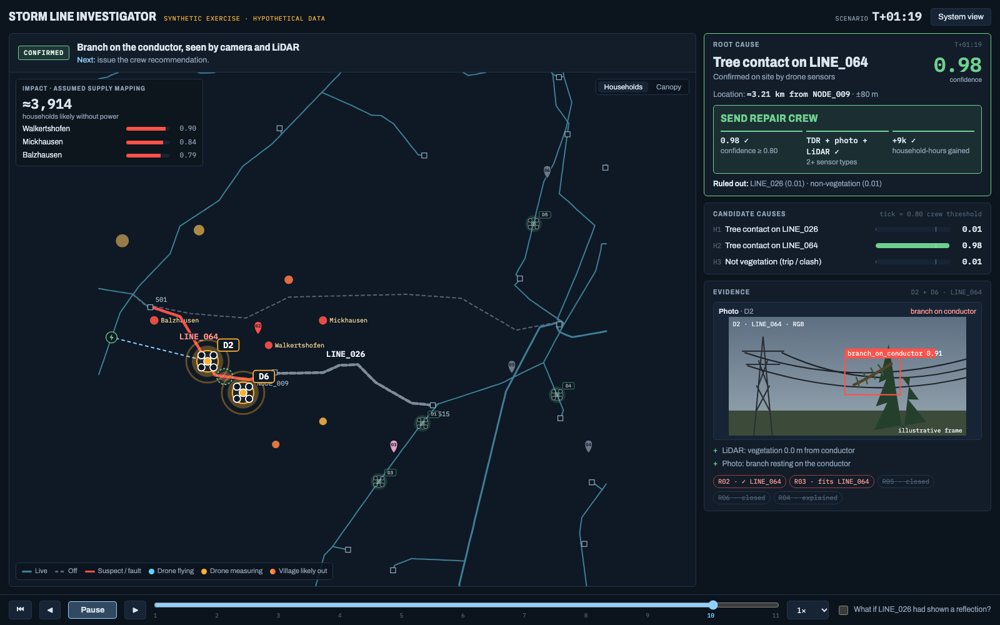

<div align="center">

# ⚡ Grid Ops

**Drones that test hypotheses, not just fly routes.**
AI-orchestrated outage diagnosis for storm-hit power grids.

[](https://www.python.org/)
[](https://docs.astral.sh/uv/)
[](https://streamlit.io/)
[](https://www.munichclimateweek.de/de/event-calendar/event/watt-the-hack-energy-ai-hackathon-evt-ffoqkynos5glo34)
[](https://www.nomadicdrone.com/)


<a href="https://www.nomadicdrone.com/">
  <picture>
    <source media="(prefers-color-scheme: dark)" srcset="docs/images/nomadic-logo-white.svg">
    
  </picture>
</a>



<sub>Storm Line Investigator (<a href="frontend-prototype.html">frontend-prototype.html</a>): the replayed incident ends with a confirmed root cause and a crew recommendation. All data is synthetic.</sub>

</div>

Built for the **Nomadic Drones challenge** at [WATT THE HACK: Energy & AI Hackathon](https://www.munichclimateweek.de/de/event-calendar/event/watt-the-hack-energy-ai-hackathon-evt-ffoqkynos5glo34), part of Munich Climate Week, on 24 October 2026 in Munich. The challenge: **Keeping the Power Flowing: Protecting Power Lines from Heat and Wildfires**.

Grid Ops is a demo of drone-assisted power-grid fault diagnosis. An AI orchestrator turns incomplete storm reports into possible causes, sends drones to test them, and recommends what the operator should do next.

## 🧠 How it works

- **AI orchestration:** Rank likely causes and choose measurements that can distinguish between them. Each change in diagnosis includes the evidence and reasoning behind it.
- **Fleet routing:** Replan the whole fleet after each reading, including drones in flight. Routes account for battery, measurement time, recharge sites and the scenario deadline; the design targets updates within one second for 95% of replans.
- **Grid physics:** Check explanations against electrical measurements and power-flow estimates. Track where the evidence is insufficient to draw a conclusion.
- **Targeted sensing:** Gather the readings needed to resolve the fault, then stop and recover the drones once the cause is supported and material alternatives are addressed.

The aim is fewer unnecessary flights and a faster, evidence-backed decision for the operator.

## 📡 Demo sensors

- **TDR (time-domain reflectometry):** Sends an electrical pulse along a conductor and measures reflections to estimate the distance to a break, short circuit or other impedance change. This narrows the area for inspection ([reference](https://download.tek.com/manual/070716905.pdf)).
- **LiDAR (light detection and ranging):** Maps conductors and nearby objects with laser ranging. This helps identify vegetation encroachment, low clearance and conductor sag ([reference](https://www.riegl.com/en-usa/faq)).

These describe the intended hardware roles. The software demo uses simulated readings.

## 🧪 What the demo tests

A hidden AC power-flow simulation supplies ground truth. The agents only see measurements; a separate evaluator compares their diagnosis with the actual fault. Every accepted route is checked for battery, timing and landing constraints.

See the [planner design](docs/planner-design.md) for assumptions and evaluation details. The presentation shows six drones; the specification uses a five-drone baseline.

## 🚀 Install and reproduce

Requires Python 3.12+ and `uv`. From the repository root:

```sh
uv sync --locked
uv run grid-ops
```

In the UI, select `incident_demo`, seed `7`, and the `scripted` autonomous manager. No API key is needed.

Run the same scenario headlessly, or compare policies across three seeds:

```sh
uv run grid-ops-eval --mode incident_demo --policy agent --seed 7
uv run grid-ops-eval --mode incident_demo --compare --seeds 7 8 9
```

Results are saved under `results/incident_demo/`. For the live LLM manager, set `OPENROUTER_API_KEY` in `.env`, then select `LLM` in the UI or add `--llm` to the agent evaluation command; live LLM responses are not deterministic.
