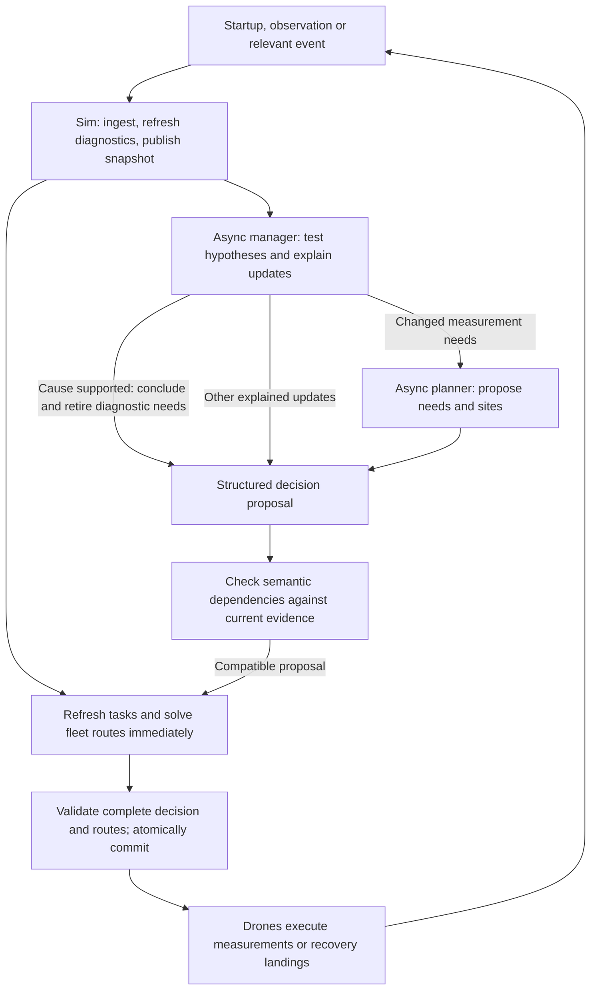

# Measurement planner design

This design turns root-cause hypotheses and drone measurements into updated investigation routes. It is a specification; the proposed functionality is not implemented yet.

**The manager's primary objective is to identify an evidence-supported root cause of the outage and recommend the next action. Collect only the information needed to resolve diagnostic uncertainty; reconstructing the full power flow is not an incident-investigation goal or completion prerequisite.** Electrical estimates support diagnosis. Every requested measurement must explain which causal uncertainty it addresses and how its result could change the diagnosis or action. Once the cause is sufficiently supported and material alternatives are addressed, stop diagnostic collection and recover the drones safely, recording remaining uncertainty. The separate `healthy_benchmark` explicitly evaluates flow reconstruction. See [workflow](planner/workflow.md#agentic-workflow) and [completion criteria](planner/validation.md#completion-and-operator-actions).

Read this index first, then load only the chapter for the task. Follow a linked dependency when changing its contract. A complete design audit uses the [validation report](planner-design-validation.md).

| Work on | Read |
|---|---|
| scope, assumptions, ownership or module boundaries | [Overview and architecture](planner/overview.md) |
| near-real-time rerouting, async manager/planner calls, event invalidation or decision acceptance | [Workflow and events](planner/workflow.md) |
| grid plausibility checks, supported conclusions, investigation completion or operator actions | [Validation and completion](planner/validation.md) |
| physical predictions, evidence interpretation, LLM-written revision reasons or the worked feedback example | [Hypotheses and explanations](planner/hypotheses.md) |
| in-progress work, reservations, repeats, battery limits, exact landings, occupancy or the deadline | [Tasks and route acceptance](planner/tasks-and-routes.md) |
| changing a shared record, command payload, public snapshot or physics interface | [Domain type sketches](planner/domain-types.md) |
| line positions, local footprints, sensor payloads, terminal-equivalent sensing, noise or negative evidence | [Geometry, sensors and coverage](planner/geometry-and-sensing.md) |
| drone transitions, energization/charging knowledge, evidence freshness, same-time events or hidden physical scheduling | [Drone state and simulation time](planner/drone-state.md) |
| synthetic truth, incident fixtures, circuit allocation, DC reduction, topology assumptions or the minimum sampling calculation | [Electrical model and scenarios](planner/electrical-model.md) |
| WLS, observability, critical sets, residual tests, priors, calibration or model discrepancy | [State estimation and uncertainty](planner/estimation.md) |
| shared-evidence rewards, urgency, CP-SAT constraints, search budgets, fallbacks or the sortie arithmetic example | [Optimization and solver guarantees](planner/optimization.md) |
| truth-isolated metrics, policy comparisons, noise replay or benchmark claims | [Evaluation](planner/evaluation.md) |
| implementation scope, required integration scenarios or explicitly deferred extensions | [Implementation and acceptance](planner/implementation.md) |

## Shared contracts

- Incident task generation, routing rewards and completion follow the root-cause objective; flow-observability gaps alone cannot create more incident work.
- Public evidence and declared assumptions drive decisions; hidden truth remains isolated.
- Every accepted hypothesis revision includes an LLM-written finding and update reason linked to evidence.
- Readings trigger fleet-wide reconsideration, including routes of airborne drones; in-progress measurements retain their reservation.
- Validate complete decisions and routes before changing accepted operational state.

For cross-cutting changes, check the owning chapter plus the contracts it references. Keep detailed definitions in their owning chapter instead of copying them into this index.

## Measurement planner spec

Proposed feature: turn storm reports and drone measurements into an evidence-supported outage diagnosis, an operator recommendation and adaptive fleet routes. Collect only evidence that can change the diagnosis or action; stop once the cause is supported and material alternatives are addressed, report remaining uncertainty and recover the drones. Full flow reconstruction is a separate `healthy_benchmark` objective.

Five drones fly straight legs at an assumed 60 km/h, with 30 minutes of airtime including measurement dwell, three hours to recharge on an eligible energized circuit, and a four-hour scenario deadline. Measurements cover electrical quantities, clearance, temperature and conductor motion.

### Packages

Python 3.12+. Keep the existing stack; add `ortools` and declare `numpy` / `scipy` as direct dependencies.

| Packages | Purpose |
|---|---|
| `langchain`, `langchain-anthropic` | Manager and planner LLMs, read-only tools and structured proposals |
| `pandapower` | Hidden synthetic AC power flow and scenario physics |
| `numpy`, `scipy` | Public reduced-DC estimation, uncertainty and consistency checks |
| `ortools` (CP-SAT) | Bounded multi-drone, multi-stop route optimization |
| `streamlit`, `pydeck` | Operator console and interactive grid, evidence and route map |

### Architecture

| Modules | Responsibility |
|---|---|
| `grid.py`, `world.py` | Network geometry, public evidence, hypotheses, tasks, reservations and drone state |
| `truth/` | Seeded electrical and local hazard simulation; expose only sensor and charging observations |
| `estimation.py`, `assessment.py` | Test hypotheses against public evidence; report consistency, coverage, uncertainty and unsupported conclusions |
| `planning.py` | Refresh candidates within accepted diagnostic needs; score unique evidence, solve sorties and independently validate routes |
| `agents.py` | Async coordinator; manager owns hypotheses, urgency and recommendations; planner proposes measurement needs and sites |
| `sim.py` | Sole writer of `World`; ingest events, publish immutable snapshots and atomically accept validated decisions |
| `app.py`, `map_view.py` | Operator controls, explained hypothesis revisions, readings, coverage, routes and unresolved actions |
| `evaluation.py` | Isolated truth-based scoring and headless policy comparisons |

Agents read pinned public snapshots and submit proposals through a versioned command queue. Every hypothesis change includes an LLM-written finding, causal update reason and evidence references. Reject stale evidence dependencies; recompute routes from live drone positions. Hidden truth and evaluator scores never reach agents.

### Agentic flow

LLM calls run while drones continue; drones have no LLM agents. Each relevant observation reconsiders the whole fleet, including mid-flight diversions, while preserving in-progress measurements. Target p95 route publication within one second and a two-second response budget. Validate battery, dwell, reservations, landing eligibility, occupancy and deadline for every route. On failure, use a validated continuation or landing-only fallback; otherwise hold and expose the required operator action.
