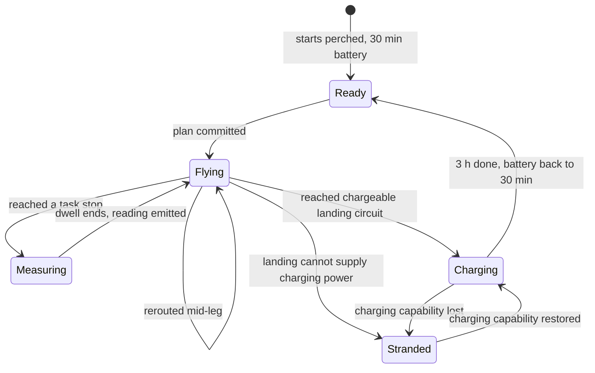

# Drone state and simulation time

[Design index](../planner-design.md). Read for drone transitions, energization/charging knowledge, evidence freshness, same-time events or hidden physical scheduling.

Related contracts: [Decision cycles](workflow.md), [Locked work](tasks-and-routes.md).

## State model

Two fields answer "where is the drone, and how much flight does it have left". They are `Drone.position` and `Drone.battery_min`. Both are exact at `world.clock`, and `advance` is the only code that changes them.

## Drone state machine

```python
@dataclass(frozen=True)
class Stop:
    task_id: str
    point: LinePoint
    position: LonLat            # resolved once with network.position_of

@dataclass(frozen=True)
class Route:
    stops: tuple[Stop, ...]     # task stops still to visit, in order
    perch: LandingSite
    perch_position: LonLat

    @property
    def target(self) -> LonLat:
        return self.stops[0].position if self.stops else self.perch_position

@dataclass(frozen=True)
class Ready:
    perch: LandingSite

@dataclass(frozen=True)
class Flying:
    origin: LonLat
    departed: float
    arrives: float              # departed + conservative rounded leg seconds / 60
    route: Route

@dataclass(frozen=True)
class Measuring:
    stop: Stop
    until: float
    route: Route                # what comes after this stop

@dataclass(frozen=True)
class Charging:
    perch: LandingSite
    until: float

@dataclass(frozen=True)
class Stranded:
    perch: LandingSite

DroneState = Ready | Flying | Measuring | Charging | Stranded

@dataclass
class Drone:
    id: str
    speed_km_per_min: float
    position: LonLat            # exact at world.clock
    battery_min: float          # airtime left, exact at world.clock
    state: DroneState
```



- **Battery drains only in `Flying` and `Measuring`,** at one minute per sim minute. It goes back to 30 only on `Charging → Ready`. Charging is all or nothing, as the rules say, so an interrupted charge starts over.
- **A route names an exact landing point and circuit.** This makes the intended endpoint explicit but does not prove reachability or chargeability. `validate_plan` checks those conditions separately.
- **Acceptance validates every route before any mutation.** Recalculate flight, locked dwell, task dwell and landing time from authoritative coordinates, speed and current battery. A rejected sortie rejects the complete candidate decision without changing any drone. Do not trust the solver's reported airtime.
- **Position follows the common geometry and time model.** For a positive-duration leg, interpolate from `origin` to `route.target` using elapsed flight fraction. A zero-distance arrival is processed immediately. At stops and landing sites, resolve the exact registered point. Geometry error is bounded by the configured route-validation tolerance rather than assumed negligible.

## Energization, chargeability and inspection state

Replace the combined `LineStatus` enum with independent public records. `CircuitKnowledge` is keyed by the explicit circuit ID and stores energization (`UNKNOWN`, `LIVE`, `DE_ENERGIZED` or `CONFLICTED`), evidence IDs, observation time and operating epoch. A segment's displayed status is derived from its circuits; one live circuit does not establish that every circuit on a shared tower is live.

`FaultAssessment` links hypotheses and local `SpanRef`s to their evidence and qualitative assessment. `InspectionCoverage` records which intervals each sensor actually inspected, under what operating conditions and in which epoch. Clearing a local suspicion changes neither energization nor chargeability.

`Chargeability` is separate from voltage presence. It is `CONFIRMED`, `UNKNOWN`, `UNAVAILABLE` or `CONFLICTED` for an exact landing circuit, with evidence and expiry. The synthetic sensor model defines sufficient charging power as a live circuit with current at least `I_CHARGE_MIN_A = 5 A`; this threshold is an exercise assumption, not a claim about real charging hardware. A measured voltage and current interval must support those conditions, or an observed successful charging handshake can confirm them directly. Hidden physics applies the same declared capability rule to actual charging. Initial perches have an explicit successful-handshake observation and full batteries, not an unexplained blanket assumption about all lines.

Observation ingestion is deterministic and precedes the manager. A high-quality voltage result incompatible with `LIVE` immediately removes that circuit from eligible perches. Simultaneous or unresolved contradictory sources yield `CONFLICTED`, not last-writer-wins. A newer direct measurement supersedes an older report about the current state, but retains the discrepancy and triggers a model or epoch review. Zero current alone never proves de-energization. The manager may interpret causes but cannot overwrite direct observations with a bare status label.

For this static-within-epoch exercise, operational evidence is fresh until a known switching or model-change event invalidates it, or until a configurable 30-minute evidence lifetime expires. `EvidenceExpired` is a scheduled event, even when no drone reading occurs. A planned landing must occur before its supporting chargeability evidence expires. A new voltage or current measurement does not extend unrelated evidence. Successful charge telemetry renews only the observed circuit's chargeability while the drone remains perched.

Default landing policy requires a fresh `CONFIRMED` chargeable circuit, no known landing hazard, and no contradiction among retained plausible operating models. `UNKNOWN`, expired or conflicted candidates may appear in previews as investigation options but are not executable recharge endpoints. A scenario may explicitly enable uncertain endpoints with a documented risk penalty and operator-visible rationale; this is a separate policy setting and cannot override known unavailability or a known landing hazard. Route feasibility always states which policy was applied.

## Time and simultaneous transitions

`advance` updates position and battery exactly to the earliest arrival, dwell completion, charge transition, evidence expiry, any scheduled hidden physical transition, declared observable scenario event or exercise deadline. Hidden transitions participate in the internal time calculation even when they produce no immediate public observation; apply them at the exact timestamp and continue advancing without a public event or hold unless an observable consequence occurs.

Before publishing an event batch, process all transitions due at that timestamp to a fixed point, including zero-distance arrivals and co-located stops.

At a timestamp, first apply and validate scheduled hidden physical changes, then resolve charging interruptions and arrivals, then take all due sensor samples from that resulting physical state, then complete charge/availability and expiry transitions. A qualified fresh observation at the exact expiry instant replaces expiring evidence before eligibility is assessed. Stable IDs break ties within these phases.

Observations at the same time are assessed together; hidden physical epoch provenance stays inside the sim and evaluator. Public readings carry only their observed timestamp and the evidence-compatibility epoch established by public reports or observed inconsistency, never a hidden incident ID. When a change becomes known later, retain raw readings and explicitly revise their epoch dispositions instead of pooling incompatible states. Reject a transition cycle that cannot make progress instead of looping forever.

Zero-distance travel completes without interpolation or battery drain. Otherwise interpolate the flight position only for a strictly positive leg duration. Use one distance model in both optimization and acceptance. For this synthetic exercise, great-circle flight length with a documented local interpolation approximation is acceptable; verification compares its maximum geometry error against the configured distance tolerance.

```text
advance(world, physics, until)
  repeatedly select the next internal or observable transition time, no later than until
  move all drones and drain flight or measurement battery to that time
  process all due transitions to a fixed point
  emit one batch containing every observable event at that time
  return after an observable batch, or when until is reached
```
