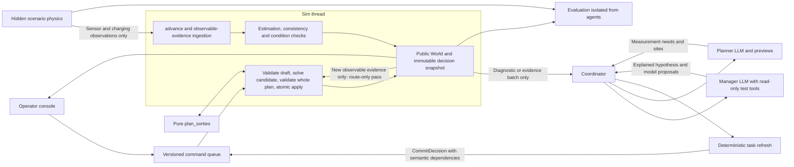

# Overview and architecture

[Design index](../planner-design.md). Read for scope, assumptions, ownership or module boundaries.

Related contracts: [Decision acceptance](workflow.md), [Shared records](domain-types.md).

## Premises

- **The map is not a 2D grid.** Drones fly in straight lines between points (`world.distance_km`), so we don't need pathfinding. The problem is choosing which measurement stops each drone visits on one flight. That is a team orienteering problem. Each drone has its own start, an airtime budget, and rewards for unique evidence needs, and a dispatched drone must reach an exact eligible recharge landing before its battery and the scenario deadline expire.
- **Speed turns distance into time.** A leg costs `distance_km / speed + dwell` minutes, and the budget is whatever airtime the drone has left. Range is not a separate constraint because it follows from speed × airtime. With today's 60 km/h (`SPEED_KM_PER_MINUTE = 1.0`), a full flight covers 30 km, which is about the width of the study area.
- **The planning horizon is bounded.** Charging takes 3 hours, and the scenario window is 4 hours. Each of the 5 drones gets at most 2 flights. Solver work has explicit budgets and fallbacks; no millisecond or optimality guarantee is assumed.
- **A flight may visit several stops.** Today `dispatch` flies to one segment midpoint, then lands and charges. A planned sortie may contain one or several measurements, or only a validated landing when recovering from a failure. Assumption: dwell time at a stop counts against airtime.
- **The planner uses public evidence and assumptions.** Landing eligibility uses circuit-specific charging knowledge, hazards, expiry and a declared risk policy, never ground truth.
- **Today there is no route optimization.** The only ranking is [agents.py:85](../../src/grid_ops/agents.py), which sorts reachable segments by distance so the drone agent's LLM can pick one. No solver is installed.
- **Today there is no power flow.** `PowerModel` in [grid.py](../../src/grid_ops/grid.py) adds external grids and calls `top.unsupplied_buses`, so it only answers whether each line is live or dead. It never calls `runpp`, and the model has no loads, generators or transformers. The dataset has no current, power or load values either.
- **Electrical estimates support outage diagnosis.** The design adds a synthetic ground truth power flow that the system never sees. The estimator uses available samples to test causal explanations and reports unsupported quantities honestly. Incident investigations collect only what is needed to identify the outage cause and recommend an action; they need not reconstruct all flows. Full reduced-model reconstruction is a separate `healthy_benchmark` objective.

## Architecture

The sim thread is the only writer of `World`. It handles bounded reactive route decisions without waiting for an LLM. The coordinator runs manager and planner calls asynchronously on immutable evidence snapshots while validated routes execute. Full source revisions preserve provenance; semantic dependency checks allow motion-only rebasing, and atomic acceptance validates current operational state. See [workflow and latency](workflow.md#in-flight-rerouting-and-latency).

| Module | Owns |
|---|---|
| `world.py` | Domain records, drone and task state machines, exact transition processing and observable events |
| `truth/` | Explicit synthetic circuit topology, AC state, local hazards, sensor likelihoods and charging physics; never copied into public state |
| `estimation.py` | Reduced public electrical model, accepted-data WLS, uncertainty, observability, detectability and hypothesis-model tests |
| `assessment.py` | Public consistency and operating-condition results, local coverage and evidence-linked recommendation checks |
| `planning.py` | Candidate refresh, information accounting, route optimization and independent route validation; pure, no I/O |
| `sim.py` | Single writer, evidence ingestion, versioned snapshots, commands, holds, atomic decision acceptance and deterministic fallbacks |
| `agents.py` | Coordinator, manager and planner prompts, snapshot-pinned tools, structured drafts and explanations |
| `evaluation.py` | Truth-based scoring and headless policy comparisons; no feedback into agents |
| `app.py`, `map_view.py` | Public hypotheses with findings and reasons, measured coverage, planned routes and unresolved actions; separate evaluation panel |

The manager can call `test_hypothesis` during its LLM turn. Candidate tests operate on the pinned snapshot, and their diagnostics are returned before the manager finalizes its explanation. A changed electrical candidate must be tested before its final revision is proposed. The sim verifies those test inputs or reruns the pure test during acceptance; an explanation referring to obsolete diagnostics is rejected for regeneration.
