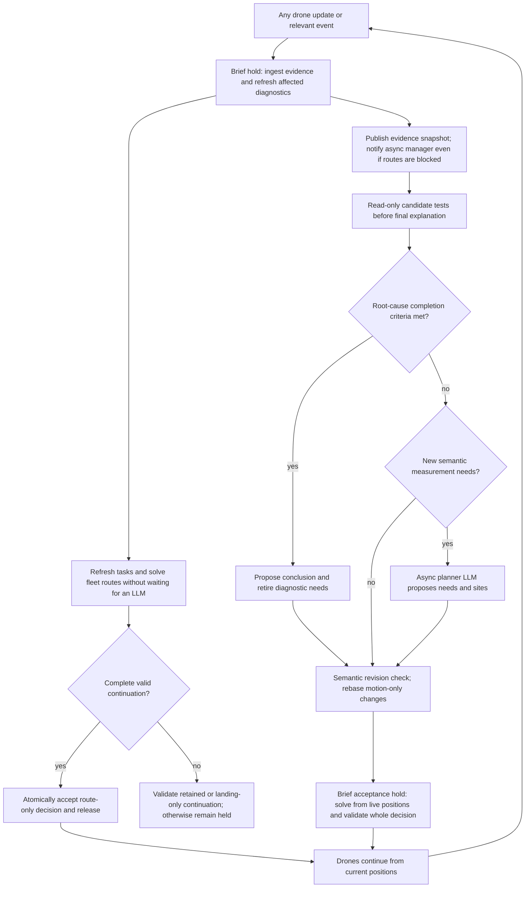

# Workflow and events

[Design index](../planner-design.md). Read for manager/planner calls, fleet-wide rerouting, event invalidation, holds or decision acceptance.

Related contracts: [Explained revisions](hypotheses.md), [Route invariants](tasks-and-routes.md), [Event timing](drone-state.md).

## Agentic workflow

There are two LLM agents and one route solver. The manager owns hypotheses, investigation urgency and recommendations. The planner proposes measurement needs and sites. Deterministic code maintains evidence, eligibility, reservations and information values. Drones execute accepted routes without drone agents.

In incident mode, the manager seeks an evidence-supported cause of the outage, not a complete electrical state. Each proposed measurement need must name the unresolved causal question, the alternatives it distinguishes and how its possible results could change the diagnosis or recommended action. The planner selects sites only for these accepted needs or explicit operational needs required for safe drone recovery. Estimation and consistency diagnostics inform this choice; missing flow observability alone does not authorize a task. H0 reconstruction needs are enabled only for the explicitly selected `healthy_benchmark`.

After each evidence batch, the manager assesses whether further diagnostic collection is necessary under the [completion criteria](validation.md#completion-and-operator-actions). If the cause is sufficiently supported and material alternatives are addressed, propose the evidence-linked conclusion and retire the incident's remaining diagnostic needs through explained revisions. Atomic acceptance cancels their unstarted tasks and routes airborne drones to validated landings; locked measurements finish. Unrelated flow gaps do not restart collection. A later relevant observation or operator request can reopen the investigation with an explained revision.

There are two decision paths. An observable event first triggers immediate deterministic fleet replanning using accepted hypotheses and the new evidence. Once a complete continuation is validated, the sim resumes. Manager and planner LLM calls run asynchronously against a pinned evidence snapshot. An explained hypothesis or measurement-needs update triggers another route pass when ready; it does not block the first pass.



`refresh_tasks` runs after relevant evidence, model, coverage, reservation, expiry or availability changes, even if hypotheses are unchanged. It refreshes canonical candidates and conditional values deterministically within active accepted needs, removing tasks whose need has been retired. It must not add a reconstruction objective or broaden diagnostic scope. When covariance is unavailable, use labelled diagnostic candidates rather than invented information gains. The planner LLM runs only when semantic measurement needs change. Its final structured proposal defines needs and sites; previews authorize no dispatch. In `healthy_benchmark`, the reconstruction completion rule replaces the root-cause branch above.

Every reading batch is retained for manager assessment. If new evidence arrives during an LLM call, the fast path still runs immediately. Coalesce unassessed batches into the next current-evidence turn and retain their event IDs. An older turn may be archived as superseded but cannot commit a hypothesis explanation against newer incompatible evidence.

## In-flight rerouting and latency

An update from any drone triggers reconsideration of the entire available fleet, including drones between stops. A `Flying` drone can divert directly from its current interpolated position; it need not finish its current leg, land or recharge first. Preserve spent battery and elapsed time. Replanning does not force every drone to divert: retain a valid next stop when switching would add no value. A `Measuring` drone finishes its locked dwell and adopts the new suffix afterwards. Charging and stranded drones stay put.

The target is a validated route update within one wall-clock second at the 95th percentile, with a two-second end-to-end response budget from observation ingestion. These are implementation acceptance targets, not measured performance. The budget includes affected checks, candidate refresh, bounded solving, validation, commit and publication. Reserve time for acceptance rather than letting the optimizer consume the entire deadline. If optimization cannot finish, validate and publish the current continuation or a landing-only fallback within the budget. A missed target is recorded; if no valid continuation exists, remain held with a visible safety exception rather than falsely reporting timely rerouting.

LLM reasoning is outside this fast-path deadline. A slow, failed or superseded manager/planner call leaves a still-valid fleet continuation running. It cannot silently change hypotheses or suppress evidence. An accepted explained hypothesis update gets its own immediate bounded route pass. At startup, initial LLM planning may finish before any drone takes off. Later short holds make decision latency free in simulation time, but do not count as meeting the wall-clock target without a measured timely response.

The coordinator uses semantic dependencies for asynchronous proposals. Evidence selection, operating epoch/model, sensor assumptions, hypothesis state, manual intent and relevant policy must still match. Continuous position, battery and route-progress changes alone do not force a new LLM call. The sim recomputes tasks, reservations and routes from live drone state at acceptance. A new reading, material condition change or conflicting operator edit invalidates the relevant proposal and requires a current-evidence explanation.

## Events and invalidation

The sim batches observable events at a timestamp and ingests them under a brief hold. Refresh affected public diagnostics first, then publish the immutable evidence snapshot and notify the asynchronous coordinator regardless of route feasibility. Refresh tasks and run the fast route pass next; publish its accepted plan or blocked-route result separately. `hold` is separate from operator pause; it lasts only for bounded route/decision acceptance or an explicit inability to continue safely. Simulation time advances while LLM calls run. Reset the wall-time baseline on each release so only the brief acceptance hold is free in simulation time.

In the table, manager and planner calls are asynchronous. A "Yes" in those columns never gates the immediate route response. New explained revisions cause a second route pass after semantic validation.

| Event | Public estimation and checks | Manager LLM | Deterministic task refresh | Planner LLM | Route solve and acceptance |
|---|---|---|---|---|---|
| Startup with reports | Prior-only estimate, model validation, report and initial charging observations | Initial explained hypotheses | Yes | Initial measurement needs | Yes |
| Electrical reading batch | Update accepted observations, estimate, observability, detectability and condition checks | Yes, including a no-change evidence assessment | Yes | Only changed semantic planning input | Yes |
| Local reading batch | Update coverage, detection conditions and hazard checks; electrical solve only if inputs changed | Yes | Yes | Only changed semantic planning input | Yes |
| Reading rejected or reinstated | Rebuild accepted-data estimate and all dependent diagnostics | Yes | Yes, including confirmation candidates | If measurement needs change | Yes |
| Known switching, model or prior change | Invalidate contradicted operational evidence immediately; check the current accepted model and test any staged replacement model, references and diagnostics | Yes; explain any hypothesis or model proposal | Yes | If measurement needs change | Yes |
| Proposed hypothesis or urgency change | Run affected hypothesis tests; candidate model changes refresh candidate diagnostics | Required explained revision | Yes | If semantic input changes | Yes |
| Drone ready | No unchanged grid solve; refresh availability | No, unless an unresolved diagnostic is also present | Yes | Normally no | Yes |
| Expected successful landing or charge telemetry | Update the observed circuit's charging evidence and occupancy | No unless evidence conflicts with expectations | Refresh affected eligibility and reservations | Normally no | Only if another route or endpoint eligibility changes |
| Stranding, lost charging power or contradictory voltage | Invalidate affected charging evidence; refresh electrical checks only from observable information | Yes | Yes | If measurement needs change | Yes |
| Evidence expiry | Invalidate affected knowledge and endpoint eligibility; retain historical readings | If diagnosis or a claim changes; not for an availability-only expiry | Yes | If new measurements are needed | Yes |
| Manual dispatch or operator evidence | Ingest evidence if provided; validate against the same public model and policies | If diagnostic facts or hypotheses change | Yes | If new measurement needs arise | Yes; manual requests cannot bypass acceptance |
| T+04:00 | Freeze scored observations, record unresolved checks and finish any permitted zero-time transitions | Final report, with explained revisions only if hypotheses change | Cancel unstarted work | No | Require landing by the deadline; a pre-existing infeasible state stays held for explicit intervention |

A physical incident inside `Simulation._truth` is not itself public evidence. Validate the hidden transition, then emit only declared observable consequences such as telemetry, a sensor reading or charging interruption. Hidden event IDs and evaluator scores never enter manager messages.

The dependency key includes evidence selection, operating epoch, electrical model and priors, sensor model, hypothesis semantics, coverage, task reservations, landing policy and drone state. Each output records the subset it depends on. Changing an explanation alone does not invalidate task geometry; changing covariance does invalidate information values. Compare full semantic hypothesis values before bumping `hypotheses_version`.

A solve reporting unassigned urgent work produces one deduplicated `PlanningBlocked` notification per unchanged cause, not an infinite manager/replan loop. The manager can explain the limitation, propose a new measurement need or recommend field inspection. It cannot make an infeasible route valid by renaming its urgency.

## Failure policy

Agent exceptions, malformed explanations, stale drafts, failed estimation, solver timeout, infeasibility and commit rejection have distinct outcomes. A failed or stale asynchronous LLM turn accepts no proposed hypothesis changes and does not pause drones already following a valid continuation. An event or acceptance pass releases its brief hold only after validating complete routes. Existing tasks may be reused only after refresh against current evidence and reservations.

Try the trimmed current continuation only if it still passes all route checks. Otherwise attempt a landing-only plan for every airborne drone under the accepted landing policy. An estimator failure marks the estimate unavailable and its conclusions unsupported; it does not invalidate independently supported landing evidence. If no valid continuation exists, keep the cycle held and expose the affected drone, constraint and required operator action. A coordinator watchdog can invoke the same deterministic fallback; it cannot invent explanations or silently accept a risk-policy change.

A route failure must not suppress an urgent diagnostic finding. After validating a manager response's schema, source and evidence links, publish an immutable `PendingDiagnosticNotice` on a separate public diagnostic channel before attempting route acceptance. It carries the proposed revisions, LLM finding and reason, independently checked recommendation, source cycle and revision, and a clear `PROPOSED_NOT_ACCEPTED` status. The UI shows it immediately beside the raw observation, including any route-blocking reason. This notice does not change accepted hypotheses, topology, tasks, routes or the decision dependency revision, and cannot authorize release. Subsequent notices link acceptance, rejection or supersession without erasing history. Accepted `World.manager_turns` link the corresponding notice. If no manager response is valid, the already-published direct condition diagnostic still shows the measured violation without an invented LLM explanation.

Each short acceptance hold has a unique `cycle_id`. Only `Release(cycle_id, accepted_decision_id)` for its still-current accepted decision can resume it. The sim invokes this automatically after a fast route-only acceptance. An asynchronous proposal carries its source cycle for provenance; it obtains a new acceptance cycle after semantic validation and never releases its old source cycle. Late releases are rejected. Repeated command IDs return stored outcomes without replaying effects.

## Simulation and decision transaction

`SnapshotRevision` records the full public snapshot, including motion and reservation revisions. `SemanticRevision` records the subset used to justify an LLM proposal: selected evidence, public epoch/model, sensor assumptions, accepted hypotheses, manual intent and applicable policy/condition dependencies. `DecisionSnapshot` is immutable and contains the source cycle, revisions, events and clock. Tools are pinned to it. UI reads may use the latest public snapshot.

Commands are `Start`, `SubmitObservation`, `RequestReadingDisposition`, `RequestModelChange`, `RequestManualDispatch`, `CommitDecision`, `Release`, `SetPaused` and `Log`. Hidden scenario control remains separate. `RequestModelChange` stages a candidate; enqueueing it cannot change the accepted model. Known switch evidence invalidates operational assumptions immediately, while a model replacement is tested and accepted with its explained revision. Agents return proposals rather than directly mutating state.

A `DecisionDraft` records its kind (`REACTIVE_ROUTES` or `EXPLAINED_UPDATE`), decision ID, source cycle/full revision, semantic dependency key, explained revisions if any, model proposals, recommendations and measurement needs. Reactive decisions use current accepted hypotheses and create no new hypothesis version. Command IDs and accepted outcomes provide retry deduplication. No-op hypotheses retain their semantic version while their evidence assessment is archived.

```text
on an observable batch or state-changing operator command
  take a brief acceptance hold and ingest evidence and direct consequences
  refresh affected public estimates and diagnostics from the new evidence
  publish the immutable evidence snapshot and notify the async coordinator
  refresh tasks and eligibility using accepted hypotheses
  solve or select a validated fleet-wide continuation within the response budget
  if a complete valid continuation exists
    atomically accept a route-only decision, publish it and release its cycle
  otherwise remain held and publish the blocked-route exception
  manager assessment proceeds in either case

asynchronously, while routes execute or a safety exception remains held
  run manager and optional planner LLM calls asynchronously on pinned inputs
  archive every reading batch and any superseded assessment
  publish valid proposed findings as pending notices without changing active state

on CommitDecision for an explained update
  verify command identity, before values, evidence and semantic dependencies
  if meaning changed, reject for a fresh current-evidence explanation
  acquire a new brief acceptance cycle and process any newly due observations
  recheck semantic dependencies before applying anything
  build a private candidate using current positions, battery and locked work
  validate explained revisions and test candidate model/hypothesis changes
  refresh candidate diagnostics and measurement needs from current accepted evidence
  solve and validate every route within the response budget
  if any check fails after hold acquisition
    discard every candidate mutation
    revalidate/accept a current route-only continuation and release that new cycle
    remain held only if no complete valid continuation exists
    return the rejection with its route-only fallback outcome
  atomically accept explanations, hypotheses, model, tasks and routes
  publish the accepted decision and release this acceptance cycle
```

Motion-only rebasing changes operational assignments, not the LLM's evidence or causal narrative. Recompute route feasibility and benefit using current reservations; never replay stale waypoint assignments. If a new observation occurs before acceptance and changes a declared dependency, abandon that proposal and schedule a current-evidence turn. The already-running valid continuation remains available. Operator edits to relevant meaning invalidate old proposals; a matching semantic key alone never bypasses before-value checks or independent route validation.

A rejected explained update retains raw observations and its clearly pending notice. It cannot partially change accepted hypotheses or routes. Every rejection after acquiring a hold invokes the same bounded route-only continuation/landing acceptance and releases its new cycle if valid. A semantically stale proposal alone cannot keep a valid flying fleet paused. Rejection before a hold leaves the current valid continuation running. Detailed latency, cycle-release and failure rules are owned by this chapter.

## Agent tools

All tools are read-only and pinned to the current `DecisionSnapshot`; results include its revision. Agents return structured proposals instead of mutating the world through tools.

| Agent | Tools |
|---|---|
| Manager | `describe_world`, `describe_segment`, `segments_in_report`, `read_evidence`, `grid_diagnostics`, `test_hypothesis`, `latest_plan`, `planning_limits` |
| Planner | `describe_segment`, `segments_in_report`, `segments_near`, `sample_points`, `drone_status`, `coverage_gaps`, `observability_gaps`, `preview_plan` |

The manager returns explained revisions, candidate model changes and recommendations. The planner returns measurement needs and exact sites. Previews show feasibility, score assumptions and unassigned reasons but authorize no dispatch. The coordinator validates the final proposal and submits `CommitDecision`; neither agent can call `SetInService`, inspect truth, overwrite direct observations or release the hold.
